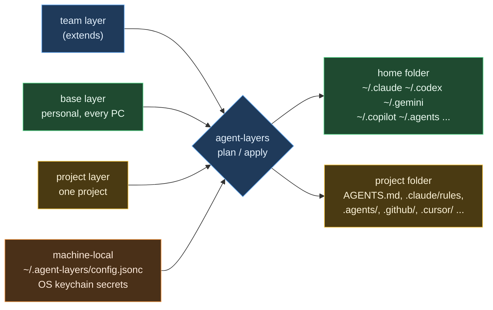

# agent-layers

Keep the configuration of all your AI coding agents in one git repository and apply it to any
machine with one command:

- a **base layer** that follows you to every PC (working rules, skills, slash commands, MCP
  servers, settings),
- **project layers** that are applied to one project folder and purged when the project ends,
- **machine-local values** (paths, secrets) that never enter the repository.

agent-layers renders one source into the native files of Claude Code, OpenAI Codex, Gemini CLI,
Google Antigravity, GitHub Copilot, Cursor, OpenCode, Zed, Junie, Kiro, Amp, Factory Droid,
Devin, Qwen Code, Cline, Goose, Kimi Code and Grok Build. It merges only the keys and blocks it owns, so files that the
agents rewrite themselves (`~/.codex/config.toml`, `~/.gemini/settings.json`, `~/.claude.json`)
keep their own content.

Zero dependencies. Node.js 18.17+. Windows, macOS, Linux, WSL.

New here? Start with the [beginner's guide](docs/GUIDE.en.md).

[한국어 문서](README.ko.md) · [처음 쓰는 사람을 위한 agent-layers 가이드 (한국어)](docs/GUIDE.ko.md)

Try the [shared-rules walkthrough](docs/SHARED-RULES.en.md): update one rule for
Claude Code, Codex and Gemini CLI in a temporary home, and check that an existing note survives.
No AI account is required.

The [workflow role-rules walkthrough](docs/WORKFLOW-ROLES.en.md) connects managed
Claude Code agent definitions to Planner, Coder, Reviewer and Auditor roles, with per-role
instructions, tools and model settings. It separates simulated verification from real AI execution.

## Why

| Problem | What agent-layers does |
|---|---|
| Every agent reads instructions, skills and MCP servers from different places and formats | One neutral source, rendered per agent (AGENTS.md, CLAUDE rules, GEMINI.md, Copilot instructions, Cursor `.mdc`, Kiro steering, ...) |
| Personal config is mixed with machine paths and client data | Layers: team/org, personal base, project, machine-local |
| Config files contain absolute paths such as `C:\Users\me\...` | Templates: `{{home}}`, `{{homeSlash}}`, `{{os}}`, `{{vars.x}}`, OS-specific files (`name@windows.ext`) |
| MCP passwords sit in plain text in `.mcp.json` | `${secret:NAME}` stored in the OS keychain; rendered as env references or injected at server start by `agent-layers exec` |
| Agents rewrite their own config files, so symlinks and whole-file sync break | Managed blocks and managed keys; drift detection; backups |
| Client knowledge stays on the machine after the engagement | `project purge` removes rendered files and the agents' per-project transcripts, memories and sessions |

## How it works



Every write is one of three kinds, and agent-layers records what it wrote in
`~/.agent-layers/state.json`:

| Kind | Example | Ownership |
|---|---|---|
| Owned file or folder | `~/.claude/rules/agent-layers/00-core.md`, `~/.agents/skills/<name>/` | the whole file |
| Managed block | `<!-- agent-layers:begin base -->` in `~/.codex/AGENTS.md` | only the block; the rest of the file is kept |
| Managed keys | `mcpServers.<name>` in `~/.gemini/settings.json`, `[mcp_servers.<name>]` in `config.toml` | only those keys; other keys and tables are kept, TOML comments are kept, and JSON files that contain comments are not rewritten without `--force` |

If something was changed outside agent-layers since the last apply (**drift**), or a file already
exists that agent-layers does not own (**conflict**), it is skipped until you pass `--force`; the
original is backed up to `~/.agent-layers/backups/` first.

## Quick start

```sh
# install the CLI
npm install --global agent-layers

# new setup repository from the template
agent-layers init
agent-layers doctor          # which agents are installed, risky configs, plaintext secrets
agent-layers plan --diff     # dry run
agent-layers apply           # write the base layer (asks for confirmation)

# existing repository on a new PC
agent-layers init --from https://github.com/you/my-agent-layers.git
agent-layers secrets check   # which secrets this machine still needs
agent-layers apply
```

`init` copies the base rule templates in English and writes the personal settings file
`base/instructions/05-persona.md` in the language of the agent instructions already on this
machine (Korean or English). Add `--lang ko` or `--lang en` to choose the language yourself.

Bootstrap scripts that also install git and Node.js: `install/install.ps1` (winget) and
`install/install.sh` (Homebrew or an existing Node.js). Download and read them before running.

Capture what you already have on this machine into the base layer:

```sh
agent-layers import --from claude,codex,gemini,copilot
```

On import, absolute home paths become `{{home}}`, and plaintext secrets in MCP server definitions
become `${secret:NAME}` references.

## Setup repository layout

```text
agent-layers.jsonc            targets, extends, vars, options
base/
  instructions/*.md          always-on rules; "paths:" front matter makes a rule path-scoped
  instructions/*.md.tmpl     rules with {{variables}}
  skills/<name>/SKILL.md     Agent Skills (agentskills.io)
  commands/*.md              slash commands using $ARGUMENTS
  agents/*.md                subagents (Claude format)
  mcp/*.jsonc                MCP servers in a neutral format
  settings/<agent>.json|toml key-level settings (claude.json, codex.toml, gemini.json, ...)
  files/<agent>/...          raw files copied into the agent's home folder (files/home/... for ~)
projects/<name>/
  project.jsonc              mode, match rules, vars, memory, purge options
  instructions/ skills/ commands/ agents/ mcp/ settings/ files/project/
```

Projects of another setup repository are imported with the `projects` field of `extends`. See "Projects from another setup repository" in the [guide](docs/GUIDE.en.md).

Neutral MCP definition:

```jsonc
{
  "command": "uvx",
  "args": ["my-mcp-server"],
  "env": { "API_URL": "https://example.com", "API_TOKEN": "${secret:example/token}" },
  "targets": ["claude", "codex", "gemini", "copilot"]   // optional
}
```

## Supported agents

| Agent | Tier | User instructions | User skills | User MCP | Project files |
|---|---|---|---|---|---|
| `claude` Claude Code | 1 | `~/.claude/rules/agent-layers/*.md` | `~/.claude/skills` | `claude mcp add-json -s user` | `AGENTS.md`, `.claude/rules`, `.mcp.json` |
| `codex` Codex | 1 | `~/.codex/AGENTS.md` (block) | `~/.agents/skills` | `~/.codex/config.toml` | `AGENTS.md`, `.codex/config.toml` (`developer_instructions`) |
| `gemini` Gemini CLI | 1 | `~/.gemini/GEMINI.md` (block) | `~/.agents/skills` | `~/.gemini/settings.json` | `AGENTS.md`, `.gemini/settings.json` |
| `antigravity` Antigravity | 1 | `~/.gemini/GEMINI.md`, `~/.gemini/config/rules` | `~/.gemini/config/skills`, `~/.gemini/antigravity-cli/skills` | `~/.gemini/config/mcp_config.json` | `.agents/rules`, `.agents/skills`, `.agents/mcp_config.json` |
| `copilot` Copilot CLI / VS Code | 1 | `~/.copilot/copilot-instructions.md`, `~/.copilot/instructions` | `~/.agents/skills` | `~/.copilot/mcp-config.json` | `AGENTS.md`, `.github/instructions`, `.mcp.json` |
| `cursor` Cursor | 1 | account UI only | `~/.agents/skills` | `~/.cursor/mcp.json` | `.cursor/rules/*.mdc`, `.cursor/mcp.json` |
| `zed` Zed | 1 | `%APPDATA%\Zed\AGENTS.md`, `~/.config/zed/AGENTS.md` | `~/.agents/skills` | - | `AGENTS.md` |
| `opencode` OpenCode | 2 | `~/.config/opencode/AGENTS.md` | `~/.agents/skills` | `opencode.json` `mcp` | `AGENTS.md` |
| `junie` Junie | 2 | `~/.junie/AGENTS.md` | `~/.agents/skills` | `~/.junie/mcp/mcp.json` | `AGENTS.md`, `.junie/rules` |
| `kiro` Kiro | 2 | `~/.kiro/steering/*.md` | `~/.kiro/skills` | `~/.kiro/settings/mcp.json` | `.kiro/steering`, `.kiro/skills` |
| `kimi` Kimi Code CLI | 2 | `~/.kimi-code/AGENTS.md` (block) | `~/.agents/skills` | `~/.kimi-code/mcp.json` | `AGENTS.md`, `.agents/skills`, `.kimi-code/mcp.json` |
| `grok` Grok Build | 2 | `~/.grok/rules/agent-layers-*.md` (one file per rule; seen with `grok inspect`) | `~/.agents/skills` | `~/.grok/config.toml` | `AGENTS.md`, `.grok/rules`, `.grok/skills`, `.grok/config.toml` |
| `amp`, `factory`, `devin`, `qwen`, `cline`, `goose` | 2 | their global `AGENTS.md`-style files | `~/.agents/skills` or their own folder | some | `AGENTS.md` or their rule folders |

Tier 1 agents are the core targets. Tier 2 agents are best effort: their paths and formats may lag
behind vendor changes. `agent-layers agents` lists the two tiers in separate tables. `doctor`
warnings of either tier make the command fail only with `--strict`.

Run `agent-layers agents` to see the resolved paths on your machine. Paths for some agents on
Windows are documented only for macOS/Linux by their vendors; treat those as best effort.

## Secrets

```sh
agent-layers secrets set github/token      # prompts without echo; stored in the OS keychain
agent-layers secrets check                 # which referenced secrets are missing here
```

| Where the config lives | How `${secret:NAME}` is rendered |
|---|---|
| Shared project files (committed) | an environment reference in the agent's own syntax (`${VAR}`, `${env:VAR}`, Codex `env_vars` / `bearer_token_env_var`) |
| Home folder or private project files, stdio servers | `node agent-layers exec --env KEY=@@secret:NAME@@ -- <server>`: the value is fetched from the keychain when the server starts and never written to disk |
| Home folder, HTTP servers | an environment reference when the agent supports one; otherwise the server is skipped for that agent with a warning, unless you set `options.secrets.mode` to `"materialize"` (values are then written into that machine-local file and redacted in `plan` output) |

Backends: Windows Credential Manager, macOS Keychain, libsecret (`secret-tool`), 1Password
(`op://` references in `secrets.map`), a plain file for CI, and `AGENT_LAYERS_SECRET_<NAME>`
environment overrides.

## Projects

To download only some projects, run `agent-layers sync --select` and pick them by number or
name, separated by commas. In scripts, name them directly:

```sh
agent-layers sync --projects sample-a,sample-b
agent-layers sync --projects extends:team
```

`--projects` takes the name of a project you already have, or `extends:<name>` for an external
repository that is not downloaded yet. A selected sync clones or pulls the whole Git repository,
so other projects in the same repository are updated too. It applies nothing: check with
`project plan`, then run `project apply`. Plain `sync` pulls every repository and applies the
base layer.

```sh
agent-layers project init sample-a --mode private --remote "github.com/sample-a/*"
agent-layers project apply            # inside the project folder; detected by git remote or folder name
agent-layers project purge sample-a   # at the end of the engagement
```

- **private** mode never edits tracked files. It writes `.claude/rules/agent-layers/project-<name>.md`,
  `.agents/rules/`, `.github/instructions/`, `.cursor/rules/`, Codex `developer_instructions` and
  similar local files, and lists them in `.git/info/exclude`. It deliberately avoids
  `CLAUDE.local.md`: when that file exists, Claude Code stops reading the repository's `AGENTS.md`.
- **shared** mode writes committable files: an `AGENTS.md` block, path-scoped rules for each
  agent, `.mcp.json` with environment references.
- `"memory": { "claude": "project" }` points Claude Code's auto memory into the project folder,
  so it is removed together with the project.
- `project purge` refuses unknown project names, needs `--path` when the project was never applied
  on this machine, refuses drive roots and folders that contain your home folder, and keeps no
  backups of what it deletes (it also deletes earlier backups of that project's files).
- `project purge` removes what agent-layers wrote and the agents' local data for that folder:
  Claude transcripts and memory (or `claude purge`), Gemini CLI `tmp/` and `history/`,
  Antigravity project settings, Codex session rollouts and Copilot session state. Global Codex
  memories and cloud-synced sessions are reported for manual review.

## Commands

| Command | Purpose |
|---|---|
| `init [dir] [--from url] [--lang lang]` | create or clone a setup repository and register it; `--lang en` or `--lang ko` sets the language of the persona file |
| `doctor [--strict]` | environment, installed agents, plaintext secrets, misplaced Codex keys, Zed/Copilot ordering, newer agent-layers version on npm; `--strict` also fails on warnings |
| `agents` | supported agents by tier and their resolved paths |
| `plan [--diff] [--all]` / `apply [--yes] [--force] [--prune]` | dry run / write the base layer; `--prune` also removes outputs of agents that are no longer selected |
| `sync` | `git pull --ff-only` the setup repository (and team layers), then apply |
| `sync --select` / `sync --projects a,b` | download only the chosen projects or `extends:<name>` repositories; applies nothing |
| `status` | managed outputs and drift |
| `show [layer] [--json]` | what each layer holds (instructions, skills, MCP servers, setting keys, files) and which agents receive it; projects as one-line summaries |
| `project list / init / detect / plan / apply / purge` | project layers |
| `secrets list / check / set / get / delete` | secrets |
| `exec --env K=V -- cmd` | run a command with secrets injected |
| `import` | capture existing user-level config |
| `validate [--strict]` | lint the setup repository (use in CI) |
| `review [--packet] [--json] [--strict]`, `review check`, `review rules` | read-only checks of the Markdown in the setup repository, and packets for an AI review (see [Markdown review](#markdown-review)) |
| `workflow plan / validate / run / status / resume / cancel / report` | preview: work on a goal with the AI CLI named in a policy file, in a separate git worktree (see [Workflow (preview)](#workflow-preview)) |
| `uninstall` | remove the files, blocks and keys written for your agents. `~/.agent-layers/` stays (state, backups, workflow records), and so do empty table headers in TOML settings files such as Codex `config.toml` |

Common options: `--only a,b`, `--skip a,b`, `--source <dir>`, `--home <dir>` (sandbox), `--json`, `--quiet`.

## Markdown review

`validate` checks the configuration format. `review` reads the `.md` and `.md.tmpl` files under
`instructions/`, `skills/`, `commands/` and `agents/` in the base, extends and project layers,
reports static findings, and lists what still needs an AI review. It only reads files; the one
exception is `review rules ... --write`, which saves `review-rules.jsonc` and keeps the previous
version in a `.bak` file next to it. Its messages and built-in rule descriptions are in Korean.

```sh
agent-layers review --source ./my-agent-layers
agent-layers review --source ./my-agent-layers --packet --json > review-packet.json
agent-layers review check --source ./my-agent-layers --input ai-result.json
agent-layers review rules list --source ./my-agent-layers
```

| Kind | What it checks |
|---|---|
| `duplicate-paragraph` | the same paragraph repeated under the same conditions; a merge candidate, never removed |
| `broken-local-link` | relative links and reference definitions that point to missing files |
| `required-sections` | headings that your own rules require |
| `manual` | contradictions, outdated workarounds, excessive checks and similar issues, left for an AI review; the CLI calls no AI |

Give the `--packet` output to the AI you already use and ask it to follow `packet.instructions`.
`review check` rejects a result made for older files, rules or settings, and reports missing or
duplicate decisions.

⚠️ Passing `review check` does not mean the AI's judgments are correct; the result says
`factualAccuracyVerified: false`.

The packet contains file contents and local paths. Known secret patterns are masked, but read the
packet before you send it anywhere; `review` itself sends nothing.

Your own rules go in `review-rules.jsonc` in the setup repository: a rule with a built-in ID
replaces it, a new ID adds a rule, and `"enabled": false` turns one off.

Plain `review` exits with 0 once the checks have run. `review --strict` exits with 1 while
anything is left, including pending AI reviews.

## Workflow (preview)

agent-layers primarily keeps your team's rules and settings consistent across AI tools.
Shared settings and role definitions can be managed and deployed without workflow; role
definitions extend that configuration management. If your AI tool's built-in task delegation
is enough, use it. Choose workflow when repeated tasks need fixed checks, recorded results and
a way to resume. Task length alone is not a reason to use it.

`agent-layers workflow` runs the AI CLI named in a policy file: it turns a goal into a plan of
steps and implements them in a separate git worktree. A run counts as complete only after the
required checks and the Reviewer and Auditor roles pass. It is a preview, so commands and output
can change in a later version.

Commit your changes first, and keep the goal and the policy outside the repository. Start the
policy from [`templates/workflow/policy.example.jsonc`](templates/workflow/policy.example.jsonc).

```sh
agent-layers workflow plan --goal-file ../goal.md --config ../policy.jsonc
agent-layers workflow validate <run-id>
agent-layers workflow run <run-id>
agent-layers workflow report <run-id>
```

`plan` and `run` show the commands and the call limit and ask before anything starts. The call
limit counts runs of the AI CLI, not tokens or money. The code of a finished run stays in its
worktree, and your repository does not change until you take it from there.

| OS | What has been run | Ctrl+C or `workflow cancel` after a process started |
|---|---|---|
| Linux | full test suite, package install, 1 run with a real AI CLI | `CANCELLED`, exit code 130; descendant processes are ended too |
| Windows | full test suite, 5 runs with a real AI CLI | `INTERRUPTED`, exit code 3; only the direct child is ended, and the run needs a new plan |
| macOS | nothing | not confirmed by running it; the code behaves as on Windows |

Exit codes mean something different from the other commands: 2 is bad input and 3 is waiting for
a person. See the [guide](docs/GUIDE.en.md#running-a-task-with-workflow-preview) for the policy
file, what is not guaranteed and the exit codes.

## Compared with other tools

Each tool below is strong at its own job, such as generating rule files, packaging skills or
syncing dotfiles. agent-layers manages the whole setup of your agents, across your machines and for
the life of a project. These are the main reasons to choose it:

- **Safe on files that agents rewrite.** It owns only its own blocks and keys in files such as
  `~/.codex/config.toml` and `~/.gemini/settings.json`. Other content stays, outside edits are
  detected as drift and skipped, and the original is backed up before `--force` replaces it.
- **Secrets stay out of the repository.** `${secret:NAME}` values live in the OS keychain or
  1Password. Generated config holds an environment reference, or a launcher that fetches the value
  when the MCP server starts. A value reaches a config file only if you opt in with
  `options.secrets.mode`.
- **One source for every machine.** A personal base layer follows you, `extends` adds team layers,
  and machine-local values and templates such as `{{home}}` keep absolute paths out of the
  repository.
- **Client work stays private and can be removed.** Private mode never edits tracked files.
  `project purge` removes what agent-layers wrote and the agents' local transcripts, memory and
  sessions for that folder, and lists global or cloud data for you to review.
- **You can check changes first and remove them later.** `plan --diff` shows each change before it
  is written, and `uninstall` removes the files, blocks and keys it wrote for your agents and keeps
  your own content. `~/.agent-layers/` and empty TOML table headers stay (see [Commands](#commands)).

| Tool | What it does well | What agent-layers adds |
|---|---|---|
| rulesync, ruler | many agents (rulesync), project and global rules, MCP config, backups and revert (ruler) | OS keychain secrets, machine-local values and templates, drift detection on files agents rewrite, `project purge` |
| Microsoft APM | dependency manager with a manifest, a lockfile and Windows installers | instructions layered per project, private client mode, `project purge` |
| chezmoi | dotfiles across machines, templates, password managers | built-in knowledge of each agent's formats and locations, so one source becomes each agent's native files |
| dotagents (iannuttall) | one `.agents` folder symlinked into six agents, global and project scope, backups | key-level merging instead of symlinks, 18 agents, MCP servers and agent settings, secrets, machine-local values, `project purge` |
| agentrig | portable plugins (skills, MCP, hooks, commands) for Claude Code, Codex and Cursor, with sharing | always-on instruction files, agent settings, keychain secrets, machine-local values |
| Claude Code plugins / claude.ai sync | native distribution of skills, commands, MCP | always-on instructions, since a plugin's `CLAUDE.md` is not loaded, and agents other than Claude |

This comparison comes from each project's own documentation as of 2026-11-03. The last column lists
what agent-layers offers and that documentation does not describe. These tools change quickly, so
check their current documentation before you decide.

agent-layers can sit next to these: keep skills in a Claude plugin marketplace, or let chezmoi
install agent-layers itself.

## Feedback

Share bugs, ideas, or suggestions through the [feedback form](https://github.com/dongple-ex/agent-layers/issues/new?template=feedback.yml).
If relevant, include your installed version (`agent-layers --version`).

## Development

```sh
npm test        # node --test, no dependencies
```

Tests run every command against a temporary home folder (`--home`), including git-based
project tests and a TOML editor that preserves comments and foreign tables.

## Status

Release 0.1.7. The npm package is `agent-layers`; run it without installing with
`npx agent-layers`, or from a clone with `node bin/agent-layers.js`.

What changed in each version is listed on
[GitHub Releases](https://github.com/dongple-ex/agent-layers/releases).
