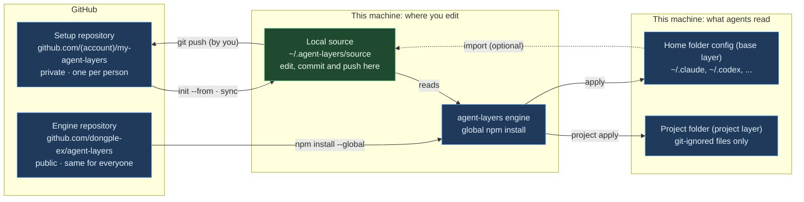

# agent-layers beginner's guide

Written: 2026-10-05 · [한국어](GUIDE.ko.md)

## Before you start

This guide walks a first-time user through agent-layers, from installation to everyday use. If you are new, read PART 1, then follow one of the two scenarios in PART 2 step by step.

| Item | Details |
| --- | --- |
| Audience | People who use two or more AI coding agents (Claude Code, Codex, Gemini CLI, ...) or want the same setup on several machines |
| Version | agent-layers 0.1.6 |
| Engine repository | [github.com/dongple-ex/agent-layers](https://github.com/dongple-ex/agent-layers) |
| Changes by version | [GitHub Releases](https://github.com/dongple-ex/agent-layers/releases) |
| Tested for this release | Automated tests on Windows 11 x64 (Node.js 24.14.1 and 18.17.0) and Linux ARM64 (Node.js 18.17.0), plus commands run from the installed package on Linux ARM64 (Node.js 24.15.0). macOS and iOS devices, and OS keychain integration have not been verified for this release |

| PART | Covers | Read first if you |
| --- | --- | --- |
| 1 Concepts | What the tool does, the terms you need, how the repositories relate | are new to agent-layers |
| 2 First install | Create a new setup repository, bring an existing one to a new machine | are about to install |
| 3 Everyday use | Add rules, skills and MCP servers, per-project settings, syncing machines, running a task with workflow (preview) | have finished installing |
| 4 Checks and troubleshooting | Check commands, FAQ, undo, command summary | ran into a problem |

---
---

# PART 1 — Concepts

## What agent-layers does

agent-layers is a command-line tool that takes the rules, skills, MCP servers and settings you keep in one git repository and writes them to the locations and formats each AI agent on your machine reads. It is not a plugin of any agent; it is a separate program you run in a terminal.

| Problem without it | With agent-layers |
| --- | --- |
| Every agent uses a different rules file name and location (`CLAUDE.md`, `AGENTS.md`, `GEMINI.md`, ...) | Write once; it is converted to each agent's location |
| A new machine means rebuilding your setup by hand | Restore it from a git repository with a few commands |
| When a client project ends, its settings and conversation history stay behind | Keep per-project settings separate and remove them in one step |
| MCP config files hold passwords in plain text | Passwords live in the OS keychain; config files hold only references |
| It is hard to tell what a change will touch | A dry run (`plan`) shows every change before writing, and overwritten files are backed up |

Eighteen agents are supported: Claude Code, Codex, Gemini CLI, Antigravity, GitHub Copilot CLI, Cursor, OpenCode, Zed, Junie, Kiro, Amp, Factory, Devin, Qwen Code, Cline, Goose, Kimi Code and Grok Build. Run `agent-layers agents` to see where each one reads its configuration.

What agent-layers does not do:

- It does not sync agent state such as sign-in data, conversation history or caches.
- It does not commit or push for you. Publishing the repository is your step.
- It never edits files that git tracks in a project repository (private mode).

## Terms you need

These six terms are enough to follow the rest of the guide. The key distinction: **everyone installs the same engine, and everyone keeps their own setup repository**.

| Term | Meaning | Example |
| --- | --- | --- |
| Engine | The `agent-layers` program you install and run | `npm install --global agent-layers` |
| Setup repository | The git repository with the source of your rules, skills, MCP servers and settings. Usually a private GitHub repository | `github.com/<account>/my-agent-layers`, cloned to `~/.agent-layers/source` |
| Base layer | The `base/` folder of the setup repository. Applied on every machine and in every project | Working rules you always follow, skills you use often |
| Project layer | A `projects/<name>/` folder. Applied only in that project folder and removed when the project ends | A client-only MCP server, personal rules for one project |
| Secret reference | `${secret:name}` written in place of a value. The real value is stored in the OS keychain on each machine | `${secret:sample-a/api-token}` |
| plan / apply | `plan` is a dry run that only shows changes; `apply` writes them | `agent-layers plan --diff`, then `agent-layers apply` |

- The OS keychain is Credential Manager on Windows, Keychain on macOS and libsecret on Linux.
- `~` is your home folder. On Windows it is `C:\Users\<user>`.

## Repositories and the direction of each command



You edit one place, the local source, and agent configuration is generated from it by `apply`. After you edit the local source and run `apply`, the engine writes each agent's own format. `git push` to GitHub and `import` of existing machine settings into the source are steps you run yourself when needed.

A project repository shared with a client or team is separate from this picture. agent-layers does not change what that repository commits; it writes only git-ignored files there (private mode).

---
---

# PART 2 — First install

## Requirements

Node.js and git are required. To share your setup repository between machines you also need a GitHub account.

| Requirement | Why | How to check |
| --- | --- | --- |
| Node.js 18.17 or later | Runs the engine. No other packages are needed | `node --version` |
| git | Downloads the setup repository from GitHub and keeps it in sync | `git --version` |
| GitHub account | Keeps the setup repository private. Not needed if you use only one machine | Sign in to github.com |
| At least one AI agent | The target of your configuration | `agent-layers doctor` after installing |
| GitHub CLI (`gh`), optional | Convenient for creating the private repository from the command line. The web works too | `gh --version` |

- On Windows the installer (`install.ps1`) installs git and Node.js with winget when they are missing.
- On macOS and Linux the installer (`install.sh`) uses Homebrew or an existing Node.js.
- After installing new programs, open a new terminal so the commands are found. A terminal inside VS Code needs VS Code to be restarted.

## Scenario A: start from scratch

Follow these steps if you do not have a setup repository yet. You create one from a template with examples, replace the examples with your own rules, apply them and push the repository to GitHub.

1. Install the engine.

   ```text
   npm install --global agent-layers
   agent-layers --help
   ```

2. Create the setup repository. The template is copied to `~/.agent-layers/source`, and that folder is registered as your source.

   ```text
   agent-layers init
   ```

   The base rule templates are copied in English. The personal settings file `base/instructions/05-persona.md` (form of address, reply language, tone, report format) is written in the language of the agent instructions already on this machine: Korean when they are mostly Korean, English when they are mostly English or when there are none. To choose the language yourself, add `--lang ko` or `--lang en`, for example `agent-layers init --lang ko`.

3. Check the agents found on this machine and any risky settings. Nothing is written.

   ```text
   agent-layers doctor
   ```

4. Replace the template examples with your own content. PART 3 shows what goes where.
   - Rewrite the three example rules and the persona file (`05-persona.md`) in `base/instructions/`.
   - Delete examples you do not need (`projects/example/`, `base/skills/commit-message/`, ...).
   - `base/mcp/github.jsonc` has `"enabled": false`, so it is not applied unless you change that.
   - To bring in settings you already use, run `agent-layers import` (see the FAQ in PART 4).

5. Preview the changes. Each file is marked as create (`create`), update (`update`) or conflict (`conflict`).

   ```text
   agent-layers plan --diff
   ```

6. Apply. Answer `y` at the prompt to write.

   ```text
   agent-layers apply
   ```

7. Start your agents again and check that the rules are in effect. Rules are read when a session starts.

8. Push the repository to GitHub as a private repository. The commands below assume you are signed in to GitHub CLI.

   ```text
   cd ~/.agent-layers/source
   git init
   git add .
   git commit -m "agent setup"
   gh repo create my-agent-layers --private --source . --remote origin --push
   ```

- Without GitHub CLI, create an empty private repository (no README) on the web, then run `git remote add origin <repository URL>` and `git push -u origin HEAD`.
- The template includes a GitHub Actions workflow (`.github/workflows/validate.yml`) that checks the repository on every push.

⚠️ Do not make the setup repository public. It may contain work rules or client names.

## Scenario B: bring your setup to a new machine

If your setup repository is already on GitHub, one installer script does the work on a new machine. The script installs, clones, checks and previews; you apply after reviewing the result.

Windows (PowerShell):

```text
Invoke-RestMethod https://raw.githubusercontent.com/dongple-ex/agent-layers/main/install/install.ps1 -OutFile install-agent-layers.ps1
powershell -ExecutionPolicy Bypass -File .\install-agent-layers.ps1 -Repo https://github.com/<account>/my-agent-layers.git
```

macOS and Linux:

```text
curl -fsSL https://raw.githubusercontent.com/dongple-ex/agent-layers/main/install/install.sh -o install-agent-layers.sh
sh install-agent-layers.sh https://github.com/<account>/my-agent-layers.git
```

Both scripts do the same steps:

1. Install git and Node.js if they are missing.
2. Install the engine.
3. Clone the setup repository to `~/.agent-layers/source` and register it as your source.
4. Run `doctor`, `secrets check` and `plan` and show the results.

Then store any missing secrets and apply:

```text
agent-layers secrets set <secret name>
agent-layers apply
```

Without the script, run these commands:

```text
npm install --global agent-layers
agent-layers init --from https://github.com/<account>/my-agent-layers.git
agent-layers doctor
agent-layers secrets check
agent-layers plan --diff
agent-layers apply
```

- The first clone of a private repository opens a GitHub sign-in window once.
- The script is downloaded to a file instead of being piped into a shell so you can read it before running it.
- To let the script run apply at the end, add `-Apply` on Windows or set `AGENT_LAYERS_APPLY=1` on macOS and Linux. You are still asked to confirm before anything is written.
- Existing settings on the new machine are kept. Rules files get a managed block added, and settings files get only the keys your repository defines.

⚠️ `init --from` stops if `~/.agent-layers/source` already contains files. To use another folder, pass it explicitly: `agent-layers init <folder> --from <URL>`.

---
---

# PART 3 — Everyday use

## Changing rules and skills

Do not edit an agent's config files directly. Edit the setup repository (`~/.agent-layers/source`) and apply. The steps are always the same:

1. Edit files in the setup repository.
2. Check the changes with `agent-layers plan --diff`.
3. Apply with `agent-layers apply`.
4. Commit and push with `git commit` and `git push`.

Use this table to decide where things go. All paths are relative to the setup repository.

| What you want to add | Where | How agents read it |
| --- | --- | --- |
| Rules to follow at all times | `base/instructions/<number>-<name>.md` | Read at the start of every session. Agents that read a single rules file get the files joined in file name order |
| Rules for specific paths only | The same kind of file with `paths:` at the top | Applied per path by agents that support it (Claude, Copilot, Antigravity, ...) |
| Rules with machine-specific values | `base/instructions/<name>.md.tmpl` | `{{home}}`, `{{os}}` and `{{vars.name}}` are replaced with each machine's values |
| Knowledge or procedures needed only sometimes | `base/skills/<name>/SKILL.md` | The agent reads it when the situation in its `description` comes up |
| Slash commands | `base/commands/<name>.md` | Converted to Markdown for Claude and TOML for Gemini |
| Subagents | `base/agents/<name>.md` | Applied to Claude only |
| Agent settings | `base/settings/claude.json`, `codex.toml`, `gemini.json` | Only the keys you write are merged; other existing settings stay |
| OS-specific settings | `@os` suffix, for example `base/settings/claude@windows.json` | Merged only on that OS |
| Setting keys to stop managing | `base/settings/_forget.jsonc`, for example `{ "codex": ["model"] }` | Keys removed from a settings file are left in place and only stop being managed |
| Files copied as they are | `base/files/<agent>/...` | Copied to the agent's home folder. `.tmpl` files are filled with variables first |

Write skills in the format below. The `description` decides whether a skill is read, so state both what it contains and when to use it. Names use lowercase letters, digits and `-`, up to 64 characters.

```markdown
---
name: commit-message
description: "Commit message rules (subject length, body format). Use when writing a commit message."
---

# Commit message rules

Body
```

- To deploy a skill to specific agents only, add `agent-layers.jsonc` to the skill folder with `{ "targets": ["claude"] }`.
- If `targets` contains an agent name that agent-layers does not know, `validate`, `plan` and `apply` stop with an `unknown target` error. `plan` and `apply` stop before they write any file.
- An empty list such as `{ "targets": [] }` deploys the skill to no agent.
- Keep always-on rules short, since agents read them in every session. Put long, occasional procedures in skills. According to the Codex docs, project `AGENTS.md` files are read only up to 32 KiB combined by default (`project_doc_max_bytes`).

⚠️ If you edit a file that agent-layers wrote, such as `~/.claude/rules/agent-layers/`, the next apply reports it as changed outside agent-layers (drift) and skips it. Always edit the setup repository.

## MCP servers and secrets

Write an MCP server once in a neutral format in `mcp/<name>.jsonc`, and it is converted to each agent's format. Write passwords and tokens as `${secret:name}` instead of values, and store the real value in the keychain once per machine.

- A server for every project: `base/mcp/<name>.jsonc`
- A server for one project: `projects/<project>/mcp/<name>.jsonc`

A server that runs on your machine (stdio):

```jsonc
{
  "command": "npx",
  "args": ["-y", "example-mcp-server"],
  "env": {
    "EXAMPLE_API_TOKEN": "${secret:example/api-token}"
  }
}
```

A remote server (HTTP). This is `base/mcp/github.jsonc` from the template without the enabled line.

```jsonc
{
  "transport": "http",
  "url": "https://api.githubcopilot.com/mcp/",
  "headers": { "Authorization": "Bearer ${secret:github/token}" },
  "targets": ["claude", "codex", "gemini", "copilot", "cursor"]
}
```

| Key | Meaning |
| --- | --- |
| `command`, `args`, `env` | The command, arguments and environment variables to run on your machine |
| `transport`, `url`, `headers` | How to reach a remote server, its URL and request headers |
| `enabled` | `false` means the server is not applied |
| `targets` | Agents that get this server. Without it, every target of the setup repository gets it |
| `${secret:name}` | A secret stored in the keychain |
| `${env:name}` | An environment variable on this machine |

Manage secrets with these commands. Names may use letters, digits and `_ . / -`; a `project/purpose` style is easy to read.

```text
agent-layers secrets set example/api-token
agent-layers secrets check
agent-layers secrets list
agent-layers secrets delete example/api-token
```

- `secrets set` asks for the value and does not echo what you type.
- `secrets check` lists secrets the setup repository refers to that this machine does not have yet.
- Servers that run on your machine are registered wrapped in `agent-layers exec`. When the server starts, exec reads the values from the keychain and passes them as environment variables.
- Remote servers are registered with environment variable references. Agents that cannot reference environment variables get a warning and the server is not written for them.

Sometimes you do not need the keychain at all:

| Case | What you need |
| --- | --- |
| A server without secrets | Nothing. Just the definition file |
| A remote server that signs in through the browser (OAuth) | Nothing. The agent opens a sign-in window on first use and stores the token itself |
| You prefer environment variables | An `AGENT_LAYERS_SECRET_<NAME>` variable. The name is upper-cased and every character other than letters and digits becomes `_`. Example: `example/api-token` → `AGENT_LAYERS_SECRET_EXAMPLE_API_TOKEN` |
| You use 1Password | Map the secret name to an `op://` path |

⚠️ A server registered with keychain secrets does not start if agent-layers is uninstalled or the keychain entry is deleted.

## Per-project settings (project layer)

A project layer holds your own settings for one project folder only. Use it to add your rules or MCP servers to a repository you share with a client or team without touching it, and remove everything in one step when the project ends.

1. Create it. `projects/sample-a/project.jsonc` is added to the setup repository.

   ```text
   agent-layers project init sample-a --mode private --remote "github.com/sample-a/*"
   ```

2. Add content. The folders are the same as in base: `projects/sample-a/instructions/`, `skills/`, `mcp/`.

3. Go to the project folder, preview and apply. Without a name, the project is found from the current folder.

   ```text
   agent-layers project plan --diff
   agent-layers project apply
   ```

4. When the project ends, purge it, then delete `projects/sample-a/` from the setup repository and commit.

   ```text
   agent-layers project purge sample-a
   ```

Projects are recognized by the rules below, not by folder path, so the same project is found even if its folder is in a different place on each machine.

| Option | Matches | Example |
| --- | --- | --- |
| `--remote` | The git remote URL. `*` is allowed | `"github.com/sample-a/*"` |
| `--dir-name` | The folder name. For repositories without a remote | `sample-a_workspace` |

There are two modes:

| Mode | Files written in the project folder | Use for |
| --- | --- | --- |
| private | Only git-ignored files (`.claude/rules/agent-layers/project-<name>.md`, ...). Their paths are added to `.git/info/exclude` | Client and team repositories. Files that git tracks are never edited |
| shared | Committable files (an `AGENTS.md` block, a `.mcp.json` with environment variable references only) | Repositories you maintain and share with a team |

Settings in `project.jsonc` you will change most often:

| Setting | Meaning |
| --- | --- |
| `"name": "sample-a"` | The project name. The folder name is used when it is left out. It starts with a letter or digit and uses only letters, digits, `.`, `_` and `-`; any other name is an error |
| `"targets": "inherit"` | Use all targets of the setup repository. Write `["claude"]` to apply only to that agent |
| `"memory": { "claude": "project" }` | Keep Claude's auto memory inside the project folder (git-excluded) so it is removed with the folder. A relative path inside the project folder also works in place of `"project"`; a path outside the project folder is not applied and is reported as an error |
| `"purge": { "agentData": true }` | `purge` also removes this project's agent conversation records |

⚠️ `project purge` is not an undo command. With `agentData` set to `true`, it also removes the project's Claude transcripts and memory, Gemini history and Codex sessions. Add `--keep-agent-data` to keep them.

### Projects from another setup repository

To share a single project with someone, keep it in a separate setup repository that holds only that project, and pull it in with the `projects` field of `extends`. Imported projects work like the ones in your own `projects/` with `project detect`, `project apply` and `project purge`.

```jsonc
"extends": [
  { "name": "sample-a", "projects": "../sample-a-agent-layers/projects", "git": "https://github.com/<account>/sample-a-agent-layers.git", "optional": true }
]
```

| Field | Meaning |
| --- | --- |
| `projects` | The `projects` folder of the other repository, relative to your setup repository |
| `path` | The base layer of the other repository. Leave it out to import projects only |
| `git` | Clone URL used by `agent-layers sync` when the folder is missing. Without `path`, it clones into the parent folder of `projects` |
| `optional` | With `true`, `validate` does not report a missing folder as an error |

- `agent-layers sync` also runs `git pull --ff-only` in the imported repository.
- The `from` column of `agent-layers project list` shows `source` (your repository) or `extends:<name>`.
- A project name that exists in both repositories is an error, because applied records are keyed by project name. Rename one of them.
- `project purge --remove-source` deletes projects of your own repository only. Delete an imported project in its own repository.

### Downloading selected projects

`agent-layers sync --select` lists projects and external project repositories registered in your current local configuration. Enter comma-separated numbers or names. Empty input, Ctrl+C, or end of input cancels the download.

| Task | Command |
| --- | --- |
| Choose multiple entries from a menu | `agent-layers sync --select` |
| Select downloaded projects by name | `agent-layers sync --projects sample-a,sample-b` |
| Select an external repository not yet downloaded | `agent-layers sync --projects extends:team` |
| Inspect downloaded projects | `agent-layers project list` |
| Preview application | `agent-layers project plan sample-a --path ./sample-a --diff` |
| Apply project settings | `agent-layers project apply sample-a --path ./sample-a` |

- In `extends:team`, `team` is the `name` of an `extends` entry in `agent-layers.jsonc`. Project names inside an undownloaded repository become available after downloading it.
- Sync clones or pulls whole Git repositories with `pull --ff-only`. Multiple selections in one repository update it only once; other project files in that repository are updated too.
- Selecting a project in your own setup repository updates that whole repository. Selecting only external repositories leaves your setup repository and other unselected repositories untouched.
- Selected sync does not apply base or project settings. The existing singular `sync --project <name>` controls application scope; the new plural `--projects` selects downloads.
- `--select` requires a terminal. Use `--projects` for automation; `--yes` does not make a selection for you.
- Unknown or ambiguous names, combining `--select` with `--projects`, and combining selection with application options fail before Git changes.
- A failed Git operation stops remaining updates. Previously updated repositories are not rolled back automatically. Resolve the failure and retry the same selection.

## Syncing machines and choosing target agents

Push changes from one machine and run `agent-layers sync` on another to reach the same state. `sync` runs `git pull --ff-only` on the setup repository and then applies the base layer.

| Task | Command |
| --- | --- |
| Get changes from another machine and apply | `agent-layers sync` |
| Also update project settings | `agent-layers project apply` in the project folder |
| Apply to some agents this time only | `agent-layers apply --only claude,codex` |
| Skip some agents this time only | `agent-layers apply --skip zed` |
| Also clean up what was written for agents you left out | `agent-layers apply --only claude --prune` |

Three ways to fix the target agents permanently:

| Scope | Where | Example |
| --- | --- | --- |
| Every machine | `targets` in the setup repository's `agent-layers.jsonc` | `"auto"` (agents found on each machine), `"all"`, or `["claude", "codex"]` |
| One project | `targets` in `projects/<name>/project.jsonc` | `["claude"]` |
| This machine only | `targets` in `~/.agent-layers/config.jsonc` | `{ "include": ["cursor"], "exclude": ["zed"] }` |

- With `targets` set to `"auto"`, a newly installed agent is included from the next apply. With an explicit list, add its name.
- Values that differ per machine (a screenshots folder, ...) go under `vars` in `~/.agent-layers/config.jsonc`. That file is not part of the setup repository.
- Some apps rewrite their own config files, the Codex desktop app for example. Run `agent-layers status` now and then and apply again if something changed.

## Running a task with workflow (preview)

`agent-layers workflow` runs the AI CLI named in a policy file: it turns a goal into a plan of steps and implements them in a separate git worktree. A run counts as complete only after the required checks and the Reviewer and Auditor roles pass. It is separate from the `plan`, `apply` and `sync` commands that deploy your setup. It is a preview, so commands and output can change in a later version.

### Getting started

1. Commit the changes in the target repository. `plan` and `run` refuse uncommitted changes with exit code 2.
2. Create the goal file and the policy file outside the repository. A new file inside it counts as an uncommitted change. Copy [`templates/workflow/policy.example.jsonc`](../templates/workflow/policy.example.jsonc) and edit it for the policy.
3. Run the commands below in order from the target repository. Use the run ID printed by `plan` for `<run-id>`. To run from another folder, add `--path <repo>` to `plan`, `run` and `resume`.

```sh
agent-layers workflow plan --goal-file ../goal.md --config ../policy.jsonc
agent-layers workflow validate <run-id>
agent-layers workflow run <run-id>
agent-layers workflow report <run-id>
```

| Command | What it does | AI calls |
| --- | --- | --- |
| `workflow plan` | Makes a plan with the Planner role and prints the run ID | yes |
| `workflow validate <run-id>` | Checks the stored plan, policy and records | no |
| `workflow run <run-id>` | Runs the plan in a separate worktree | yes |
| `workflow status <run-id>` | Shows step states, attempts and budget use | no |
| `workflow report <run-id>` | Shows check results, artifacts, remaining steps and what is not guaranteed | no |
| `workflow resume <run-id>` | Continues a stopped run. If the reason for the stop cannot be continued, it ends without a call | only when it continues |
| `workflow cancel <run-id>` | Asks a running run to stop and waits for the result. Ctrl+C in the terminal of the run does the same | no |

The status of the run and the `last error` column of the step say why a run stopped. For most `BLOCKED` reasons, the `next:` line of `workflow report` says what to do next. A run stops with `transport` when AI CLI calls keep ending with an error. That covers every call that ends with a non-zero exit code or a signal, not only network errors. Fix the cause, then run `resume`, which continues in the same worktree. A run that ended as `FAILED` or `CANCELLED` does not resume, so make a new plan. Every command accepts `--json`.

### Approval and call limits

- `plan`, `run` and `resume` show the commands, the target repository and the call limit, and ask for confirmation before they start. `run` and `resume` also show the steps, write paths and checks.
- Without a terminal and without `--yes`, they stop with exit code 3. The AI CLI, setup commands and checks do not start.
- `--yes` skips this confirmation. Read what is shown before you add it.
- The call limit `limits.maxAgentCalls` (default 20) counts how many times the AI CLI is run. It does not limit the model requests inside one run of the CLI, tokens or money.
- The time limits are `limits.stepTimeoutSeconds` per call (default 900 seconds) and `limits.runTimeoutSeconds` for the whole run (default 3600 seconds).

### The policy file

The comments in the example file explain `setup`, `baseline`, `inputs` and `failedTestPattern`. Check these first:

- The `provider` command must take its instructions on stdin and print its final message on stdout. Its flags belong to that CLI and can change with its version, so check them with its `--help`.
- On Windows a `.cmd` file cannot start without a shell, so `plan` refuses it with exit code 2. That includes `codex` installed with npm, and `npm` itself, so the example file is refused as it stands. For `provider`, use `"command": "node"` and put the path of the package's bin script first in each `args` list. Do the same for `npm` in `checks` and `setup`, or for a test check name the test runner directly, such as `"command": "node"` with `"args": ["--test"]`.
- Secrets never go in the policy file. List only the names of the environment variables to pass on under `provider.env`.

⚠️ Do not remove `-c approval_policy=never` from the Codex example. Depending on your settings, a helper model that you did not approve can approve running outside the sandbox.

### Checking the result

- `SUCCEEDED` means the checks and reviews of the program passed. It does not mean the result is exactly what you wanted.
- The target repository does not change when a run ends. The code is only in the folder on the `worktree:` line of `report`, so take the changes you want from there and commit them yourself.
- A worktree is not removed automatically. After taking the changes, remove it with `git worktree remove --force <worktree>`.

⚠️ `--force` also deletes changes you did not take, and the deleted code cannot be recovered.

### What is not guaranteed

This is the same as the `not guaranteed` list printed by `workflow report`.

| Item | Details |
| --- | --- |
| Isolation | Sandboxing is left to the AI CLI and the policy, and setup commands and checks run with your permissions |
| Write scope | Checked after each call, not blocked; paths of earlier steps and files git ignores are not counted |
| Processes | One that left its session is not found when a run ends, is cancelled or is resumed |
| AI CLI settings | Changes a CLI makes to its own global settings are not cleaned up |
| Model and usage | Not recorded; only calls and active time are counted |
| Result patch | A record with secret-looking lines masked; take the change from the worktree |

### Supported environments

Node.js 18.17 or later is required. No operating system is refused, but they behave differently when a run is stopped.

| OS | What has been run | Ctrl+C, `workflow cancel` | Resuming a stopped run |
| --- | --- | --- | --- |
| Linux | Full test suite, package install, 1 run with a real AI CLI (Codex CLI) | `CANCELLED`, exit code 130. Descendant processes are ended too | If the managing process is killed, the children it left are not ended automatically and resume is refused. End those processes, then run `resume` again |
| Windows | Full test suite, 5 runs with a real AI CLI (Codex CLI 3, Claude Code 2) | `INTERRUPTED`, exit code 3. Only the direct child is ended, so descendant processes may keep running | Stops with `process-unconfirmed` and does not continue. A new plan is needed |
| macOS | Nothing has been run | Treated as a non-Linux OS, so the code behaves as on Windows. Not confirmed by running it | The code behaves as on Windows. Not confirmed by running it |

The table covers a stop after at least one process has started. A cancel before any process starts ends as `CANCELLED` with exit code 130 on every OS.

### Exit codes

Exit codes of the workflow commands mean something different from the other agent-layers commands. The others mostly return 1 even for bad input, and use 2 only for an unknown command. Keep this in mind when a script reads the exit code.

| Code | Meaning | Examples |
| --- | --- | --- |
| 0 | Completed, or a query succeeded | `SUCCEEDED`. `status` and `report` return 0 when the query works, even if the run failed |
| 1 | The run failed | `FAILED` |
| 2 | Bad input, or a state that cannot run | A bad option, uncommitted changes, `resume` of a run that has ended |
| 3 | Waiting for input, approval or recovery by a person | `BLOCKED`, `INTERRUPTED`, no terminal and no `--yes`, a run another process is working on |
| 130 | Cancelled | `CANCELLED` |

---
---

# PART 4 — Checks and troubleshooting

## Check commands

All of these commands are read-only and safe to run at any time. When something goes wrong, start with `doctor` and `status`.

| Command | Checks | When |
| --- | --- | --- |
| `agent-layers doctor` | Installed agents, plain-text passwords in config files, settings in the wrong place, rules file sizes | After installing, or when something behaves oddly |
| `agent-layers status` | Files agent-layers manages and files changed outside it since the last apply | When you suspect a config file was edited by hand |
| `agent-layers show` | Instructions, skills, MCP servers, setting keys and files in each layer, the agents that receive them, and the project list. `show <name>` details one layer | When you want to see what your setup repository holds at a glance |
| `agent-layers plan --diff` | What an apply would change, line by line | Every time before applying |
| `agent-layers validate` | Format errors, plain-text secrets, invalid skill names and unknown target agent names in the setup repository | Before committing |
| `agent-layers secrets check` | Secrets the setup repository refers to that this machine lacks | After bringing your setup to a new machine |
| `agent-layers agents` | Each supported agent's config locations and when they were checked | When you want to know where files go |

How to read `plan` output:

| Mark | Meaning | On apply |
| --- | --- | --- |
| `create` | Will be created | Written |
| `update` | Will be changed, including an added managed block or merged keys | Written |
| `unchanged` | Already the same | Nothing happens |
| `conflict` | Overlaps existing content that agent-layers does not manage | Skipped unless you pass `--force` |
| `drift` | Changed outside agent-layers after it was written | Skipped unless you pass `--force` |
| `remove` | Removed from the source and will be cleaned up | Deleted |

- `--force` backs up the original file before overwriting it.
- "Executable content" at the end of `plan` lists commands that will run with your user rights (MCP servers, skill scripts, the status line, ...). Make sure you recognize them.
- Files copied as they are into your home or project folder (`files/home/`, `files/project/`) are listed there too, as `home file:` and `project file:`, because startup items and shell profiles can run whatever their extension.
- Links (symlinks, junctions) inside the setup repository are copied only when they point to a file inside the same layer folder. Links that point outside the layer or to a folder are not copied, and a warning is shown.
- Control characters in the output are shown as visible text such as `\x1b`.
- Password and token values are shown as `***` in `--diff` output.

## FAQ

**Does `init` put this machine's settings into the setup repository?**

No. `init` only decides which repository is your source. Without `--from` it creates a template with examples; with `--from` it clones an existing repository. The command that brings this machine's existing settings into the repository is `agent-layers import`.

- `import` lists the files it would bring in and writes them to the base layer of the setup repository after you confirm.
- Home paths become variables such as `{{home}}`, and plain-text secrets become `${secret:...}` references.
- Files that already exist in the repository are not overwritten unless you add `--overwrite`.
- After importing, remove duplicates and client information yourself, then commit.

**Is it only for Claude?**

No. It is a separate program that configures eighteen agents from the same repository. Slash commands are converted only for Claude and Gemini, and subagents only for Claude.

**Do I always need the keychain to add an MCP server?**

No. Only servers that need a password or token in their configuration need a one-time `secrets set` per secret on each machine. Servers without secrets, or servers that sign in through the browser, do not.

**What happens if I edit an agent's config file directly?**

If you edited a part agent-layers wrote, the next apply reports it as `drift` and skips it. To keep the change, move it into the setup repository; to discard it, overwrite with `apply --force`. Parts agent-layers did not write are yours to edit freely.

**Will my existing rules files or settings be deleted?**

No. Rules files get a managed block marked "Managed by agent-layers", and settings files get only the keys in your repository merged in. JSON settings files that contain comments are not rewritten without `--force`.

**Are both a project's `AGENTS.md` and my base rules applied?**

Both are read. In case they disagree, state the priority in your base rules, for example "if the project rules say otherwise, follow the project rules". The more they overlap, the more context every session uses.

**Can I keep the setup repository in a synced folder such as Google Drive instead of GitHub?**

It works: register the folder with `agent-layers init <folder>`, and `sync` then skips the pull and only applies. However, conflict copies created by the sync client may be read as rules, and there is no change history, so a private git repository is recommended.

**How do I update the engine?**

Run the install command again. It moves to the latest version on npm.

```text
npm install --global agent-layers
```

To see whether a new version is out, run `agent-layers doctor`. The `agent-layers` row in the Environment table shows the installed version and the latest version on npm, and when a newer version exists, Checks shows the update command. The command matches how you installed it (npm, npx or a clone). The latest version is looked up with `npm view`; `--fast` skips the lookup.

## Undo and cautions

Overwritten files are always backed up, so most changes can be undone. The exception is agent conversation records removed by `project purge`.

| Task | How |
| --- | --- |
| Restore a file to its state before apply | Copy the original from `~/.agent-layers/backups/<date-time>/` |
| Remove one rule or skill | Delete it from the setup repository and `apply`. Items removed from the source are cleaned up in agent config too |
| Remove everything from one agent | Take it out of `targets` and run `apply --prune` |
| Remove what agent-layers wrote for your agents | `agent-layers uninstall`. Other content stays. The table below lists what else stays |
| Remove the engine too | `agent-layers uninstall`, then `npm uninstall --global agent-layers` |
| Delete a secret | `agent-layers secrets delete <name>` |

`uninstall` leaves these in place:

| What stays | Details |
| --- | --- |
| `~/.agent-layers/` | `state.json`, `backups/`, workflow records in `workflows/`, `config.jsonc`, and the setup repository if it is in `source/`. `backups/` also holds the copies `uninstall` makes of what it removes |
| TOML settings files (Codex, Grok, Kimi `config.toml`) | The empty header of each table agent-layers wrote to, such as `[features]`. The values are removed. Because of these headers, a file agent-layers created also stays |
| Empty folders | Folders such as `.claude/skills` stay after the files in them are removed |
| Keychain secrets | Run `agent-layers secrets delete <name>` to delete one |

Cautions:

- Keep the setup repository private. It may contain work rules and project names.
- Never write passwords or tokens into the setup repository in plain text. Run `validate` before committing.
- Do not apply if "Executable content" in `plan` shows a command you do not recognize. Check this carefully when you pull in someone else's setup repository through `extends`.
- The backup folder keeps config files exactly as they were before being overwritten. If an original held a plain-text password, so does its backup; delete backups once you have checked them.

⚠️ MCP servers registered with keychain secrets stop starting once the engine is removed. Run `uninstall` to clean up the registrations before removing the engine.

## Command summary

Commands marked "yes" in the read-only column write nothing and can be run at any time.

| Group | Command | What it does | Read-only |
| --- | --- | --- | --- |
| Install | `npm install --global agent-layers` | Installs or updates the engine | no |
| Install | `agent-layers init` | Creates a new setup repository from the template and registers it. `--lang ko` or `--lang en` sets the persona file language | no |
| Install | `agent-layers init --from <URL>` | Clones an existing setup repository and registers it | no |
| Install | `agent-layers import --from claude,codex` | Brings this machine's existing settings into the setup repository | no |
| base | `agent-layers plan --diff` | Shows what an apply would change | yes |
| base | `agent-layers apply` | Applies the base layer | no |
| base | `agent-layers sync` | Pulls the setup repository, then applies | no |
| base | `agent-layers status` | Shows managed files and files changed outside agent-layers | yes |
| base | `agent-layers show [name]` | Shows what each layer holds and which agents receive it | yes |
| base | `agent-layers uninstall` | Removes the files, blocks and keys written for your agents. "Undo and cautions" lists what stays | no |
| project | `agent-layers project init <name> --mode private --remote <URL>` | Creates a project layer | no |
| project | `agent-layers project list` | Lists project layers | yes |
| project | `agent-layers project detect` | Shows which project the current folder belongs to | yes |
| project | `agent-layers project plan --diff` | Previews a project layer | yes |
| project | `agent-layers project apply` | Applies a project layer | no |
| project | `agent-layers project purge <name>` | Removes a project layer and its agent records | no |
| Secrets | `agent-layers secrets set <name>` | Stores a secret in the keychain | no |
| Secrets | `agent-layers secrets check` | Shows secrets missing on this machine | yes |
| Secrets | `agent-layers secrets list` | Lists stored secret names | yes |
| Secrets | `agent-layers secrets delete <name>` | Deletes a secret | no |
| Checks | `agent-layers doctor` | Checks agents and risky settings | yes |
| Checks | `agent-layers validate` | Checks the setup repository | yes |
| Checks | `agent-layers agents` | Shows supported agents and their config locations | yes |
| workflow (preview) | `agent-layers workflow plan --goal-file <file> --config <file>` | Makes a plan with the AI CLI and prints the run ID | no |
| workflow (preview) | `agent-layers workflow validate <run-id>` | Checks the stored plan, policy and records | yes |
| workflow (preview) | `agent-layers workflow run <run-id>` | Runs the plan in a separate worktree | no |
| workflow (preview) | `agent-layers workflow status <run-id>` | Shows step states, attempts and budget use | yes |
| workflow (preview) | `agent-layers workflow report <run-id>` | Shows check results, artifacts, remaining steps and what is not guaranteed | yes |
| workflow (preview) | `agent-layers workflow resume <run-id>` | Continues a stopped run | no |
| workflow (preview) | `agent-layers workflow cancel <run-id>` | Asks a running run to stop and waits for the result | no |

Options shared by many commands:

| Option | Meaning |
| --- | --- |
| `--only a,b` / `--skip a,b` | Apply only to some agents, or leave some out |
| `--yes` | Proceed without confirmation prompts |
| `--force` | Back up and overwrite files in conflict or changed outside agent-layers |
| `--source <folder>` | Use another setup repository instead of the registered one |
| `--home <folder>` | Use another home folder for a trial run without touching your real configuration |
| `--json` / `--quiet` | Machine-readable output / less output |
