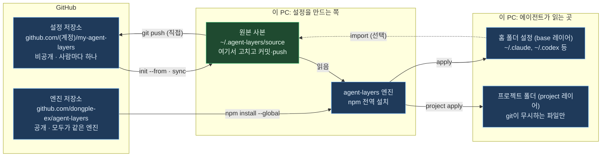

# agent-layers 처음 사용자 가이드

작성일: 2026-10-05 · [English](GUIDE.en.md)

## 읽기 전에

이 문서는 agent-layers를 처음 쓰는 사람이 설치부터 매일 쓰는 방법까지 순서대로 따라 할 수 있게 정리한 안내서입니다. 처음이라면 PART 1을 읽고, PART 2의 시나리오 하나를 그대로 따라 하면 됩니다.

| 항목 | 내용 |
| --- | --- |
| 대상 | Claude Code, Codex, Gemini CLI 같은 AI 코딩 에이전트를 두 개 이상 쓰거나, 여러 PC에서 같은 설정을 쓰고 싶은 사람 |
| 기준 버전 | agent-layers 0.1.6 |
| 엔진 저장소 | [github.com/dongple-ex/agent-layers](https://github.com/dongple-ex/agent-layers) |
| 이번 버전의 검증 환경 | Windows 11 x64(Node.js 24.14.1, 18.17.0)와 Linux ARM64(Node.js 18.17.0) 자동 테스트, Linux ARM64(Node.js 24.15.0)에서 설치한 패키지의 명령 실행. macOS·iOS 실기기, OS 키체인 연동은 이번 버전에서 검증하지 않았습니다 |

| PART | 다루는 내용 | 먼저 읽을 사람 |
| --- | --- | --- |
| 1 개념 | 무엇을 하는 도구인지, 꼭 알아야 할 용어, 저장소 사이의 관계 | 처음 접하는 사람 |
| 2 처음 설치 | 설정 저장소를 새로 만들기, 기존 설정을 새 PC로 가져오기 | 설치하려는 사람 |
| 3 매일 쓰기 | 규칙·스킬·MCP 추가, 프로젝트별 설정, 여러 PC 동기화, workflow로 작업 실행하기 (preview) | 설치를 마친 사람 |
| 4 점검과 문제 해결 | 점검 명령, 자주 묻는 질문, 되돌리기, 명령 요약 | 문제가 생긴 사람 |

---
---

# PART 1 — 개념

## agent-layers가 하는 일

agent-layers는 git 저장소 하나에 적어 둔 규칙·스킬·MCP 서버·설정을, PC에 설치된 여러 AI 에이전트가 각자 읽는 위치와 형식으로 바꿔 써 주는 명령줄 도구입니다. 특정 에이전트의 플러그인이 아니라 터미널에서 따로 실행하는 프로그램입니다.

| 없을 때의 문제 | agent-layers를 쓰면 |
| --- | --- |
| 에이전트마다 규칙 파일 이름과 위치가 다릅니다 (`CLAUDE.md`, `AGENTS.md`, `GEMINI.md` 등) | 한 곳에 쓰면 각 에이전트의 위치로 변환해 씁니다 |
| PC를 바꾸면 설정을 처음부터 다시 만들어야 합니다 | git 저장소에서 명령 몇 개로 복원합니다 |
| 고객사 프로젝트가 끝나도 그 프로젝트용 설정과 대화 기록이 남습니다 | 프로젝트별 설정을 따로 두고, 끝나면 한 번에 지웁니다 |
| MCP 설정 파일에 비밀번호가 평문으로 남습니다 | 비밀번호는 OS 키체인에 두고, 설정에는 참조만 씁니다 |
| 설정을 바꾸면 무엇이 바뀌는지 알기 어렵습니다 | 쓰기 전에 미리 보기(`plan`)로 바뀌는 내용을 보여 주고, 덮어쓴 파일은 백업합니다 |

대상 에이전트는 16종입니다: Claude Code, Codex, Gemini CLI, Antigravity, GitHub Copilot CLI, Cursor, OpenCode, Zed, Junie, Kiro, Amp, Factory, Devin, Qwen Code, Cline, Goose. 에이전트별 설정 위치는 `agent-layers agents`로 확인합니다.

agent-layers가 하지 않는 일도 있습니다.

- 로그인 정보, 대화 기록, 캐시 같은 에이전트의 상태 파일은 동기화하지 않습니다.
- git commit과 push를 대신 하지 않습니다. 저장소에 올리는 일은 사용자가 직접 합니다.
- 프로젝트 저장소에서 git이 추적하는 파일은 고치지 않습니다(private 모드).

## 꼭 알아야 할 용어

아래 6개만 알면 나머지 설명을 따라갈 수 있습니다. 가장 중요한 구분은 **엔진은 모두가 같은 것을 쓰고, 설정 저장소는 각자 만든다**는 점입니다.

| 용어 | 뜻 | 예 |
| --- | --- | --- |
| 엔진 | 설치해서 실행하는 `agent-layers` 프로그램 | `npm install --global agent-layers` |
| 설정 저장소 | 내 규칙·스킬·MCP·설정의 원본을 담는 git 저장소. 보통 비공개 GitHub 저장소로 둡니다 | `github.com/<계정>/my-agent-layers`, PC에서는 `~/.agent-layers/source` |
| base 레이어 | 설정 저장소의 `base/` 폴더. 모든 PC, 모든 프로젝트에 적용합니다 | 항상 지킬 작업 규칙, 자주 쓰는 스킬 |
| project 레이어 | 설정 저장소의 `projects/<이름>/` 폴더. 그 프로젝트 폴더에서만 적용하고, 끝나면 지웁니다 | 고객사 전용 MCP, 그 프로젝트에서만 쓸 개인 규칙 |
| 비밀값 참조 | 설정에 값 대신 적는 `${secret:이름}`. 실제 값은 PC마다 OS 키체인에 저장합니다 | `${secret:sample-a/api-token}` |
| plan / apply | `plan`은 바뀔 내용만 보여 주는 미리 보기, `apply`는 실제로 쓰는 적용입니다 | `agent-layers plan --diff` 뒤 `agent-layers apply` |

- OS 키체인은 Windows에서는 자격 증명 관리자, macOS에서는 키체인, Linux에서는 libsecret입니다.
- `~`는 홈 폴더입니다. Windows에서는 `C:\Users\<사용자>`입니다.

## 저장소와 명령의 방향



고치는 곳은 원본 사본 하나이고, 에이전트 설정은 `apply`로 만들어집니다. 원본 사본을 고친 뒤 `apply`를 실행하면 엔진이 각 에이전트의 형식으로 씁니다. GitHub로 올리는 `git push`와, 이 PC의 기존 설정을 원본으로 가져오는 `import`는 필요할 때 사용자가 직접 실행합니다.

고객사나 팀이 함께 쓰는 프로젝트 저장소는 이 그림과 별개입니다. agent-layers는 그 저장소의 커밋 대상을 바꾸지 않고, git이 무시하는 파일에만 씁니다(private 모드).

---
---

# PART 2 — 처음 설치

## 준비물

필수는 Node.js와 git 두 가지입니다. 설정 저장소를 다른 PC와 나눠 쓰려면 GitHub 계정도 필요합니다.

| 준비물 | 필요한 이유 | 확인 방법 |
| --- | --- | --- |
| Node.js 18.17 이상 | 엔진을 실행합니다. 다른 패키지는 필요하지 않습니다 | `node --version` |
| git | 설정 저장소를 GitHub에서 내려받고 동기화합니다 | `git --version` |
| GitHub 계정 | 설정 저장소를 비공개로 보관합니다. 한 PC에서만 쓸 때는 없어도 됩니다 | github.com 로그인 |
| AI 에이전트 1개 이상 | 설정을 적용할 대상입니다 | 설치 후 `agent-layers doctor` |
| GitHub CLI(`gh`), 선택 | 비공개 저장소를 명령으로 만들 때 편합니다. 웹에서 만들어도 됩니다 | `gh --version` |

- Windows에서는 설치 스크립트(`install.ps1`)가 git과 Node.js가 없으면 winget으로 설치합니다.
- macOS·Linux에서는 설치 스크립트(`install.sh`)가 Homebrew나 이미 설치된 Node.js를 씁니다.
- 프로그램을 새로 설치한 뒤에는 터미널을 새로 열어야 명령을 찾습니다. VS Code 안의 터미널은 VS Code를 다시 시작해야 합니다.

## 시나리오 A: 처음부터 만들기

설정 저장소가 아직 없다면 이 순서를 따릅니다. 예시가 들어 있는 템플릿으로 저장소를 만들고, 예시를 내 규칙으로 바꾼 뒤 적용하고 GitHub에 올립니다.

1. 엔진을 설치합니다.

   ```text
   npm install --global agent-layers
   agent-layers --help
   ```

2. 설정 저장소를 만듭니다. `~/.agent-layers/source`에 템플릿이 복사되고, 이 폴더가 원본으로 등록됩니다.

   ```text
   agent-layers init
   ```

   기본 규칙 템플릿은 영어로 복사됩니다. 개인 설정 파일인 `base/instructions/05-persona.md`(호칭, 응답 언어, 말투, 보고 형식)는 이 PC에 있는 기존 에이전트 지시문의 언어로 만들어집니다. 기존 지시문이 한국어 위주면 한국어로, 영어 위주이거나 지시문이 없으면 영어로 만들어집니다. 언어를 직접 정하려면 `agent-layers init --lang ko`처럼 `--lang ko` 또는 `--lang en`을 붙입니다.

3. 이 PC에서 찾은 에이전트와 위험한 설정을 점검합니다. 아무것도 쓰지 않습니다.

   ```text
   agent-layers doctor
   ```

4. 템플릿의 예시를 내 내용으로 바꿉니다. 무엇을 어디에 넣는지는 PART 3의 표를 봅니다.
   - `base/instructions/`의 예시 규칙 3개와 페르소나 파일(`05-persona.md`)을 내 규칙으로 고칩니다.
   - 필요 없는 예시(`projects/example/`, `base/skills/commit-message/` 등)는 지웁니다.
   - `base/mcp/github.jsonc`는 `"enabled": false`라서 그대로 두면 적용되지 않습니다.
   - 이미 쓰던 설정을 가져오려면 `agent-layers import`를 씁니다(PART 4 자주 묻는 질문 참고).

5. 바뀔 내용을 미리 봅니다. 파일마다 만들기(`create`), 고치기(`update`), 충돌(`conflict`)이 표시됩니다.

   ```text
   agent-layers plan --diff
   ```

6. 적용합니다. 확인 질문에 `y`를 입력하면 씁니다.

   ```text
   agent-layers apply
   ```

7. 에이전트를 새로 시작해서 규칙이 적용되었는지 확인합니다. 규칙은 세션을 시작할 때 읽힙니다.

8. GitHub에 비공개 저장소로 올립니다. 아래는 GitHub CLI에 로그인한 경우입니다.

   ```text
   cd ~/.agent-layers/source
   git init
   git add .
   git commit -m "agent setup"
   gh repo create my-agent-layers --private --source . --remote origin --push
   ```

- GitHub CLI가 없으면 웹에서 README 없이 빈 비공개 저장소를 만든 뒤, `git remote add origin <저장소 주소>`와 `git push -u origin HEAD`를 실행합니다.
- 템플릿에는 push할 때마다 저장소를 검사하는 GitHub Actions(`.github/workflows/validate.yml`)가 들어 있습니다.

⚠️ 설정 저장소는 공개로 만들지 않습니다. 업무 규칙이나 고객사 이름이 들어갈 수 있습니다.

## 시나리오 B: 새 PC에 가져오기

이미 GitHub에 설정 저장소가 있다면 새 PC에서는 설치 스크립트 하나로 끝납니다. 스크립트는 설치, 저장소 복제, 점검, 미리 보기까지 하고, 실제 적용은 결과를 본 뒤 직접 합니다.

Windows(PowerShell):

```text
Invoke-RestMethod https://raw.githubusercontent.com/dongple-ex/agent-layers/main/install/install.ps1 -OutFile install-agent-layers.ps1
powershell -ExecutionPolicy Bypass -File .\install-agent-layers.ps1 -Repo https://github.com/<계정>/my-agent-layers.git
```

macOS·Linux:

```text
curl -fsSL https://raw.githubusercontent.com/dongple-ex/agent-layers/main/install/install.sh -o install-agent-layers.sh
sh install-agent-layers.sh https://github.com/<계정>/my-agent-layers.git
```

두 스크립트가 하는 일은 같습니다.

1. git과 Node.js가 없으면 설치합니다.
2. 엔진을 설치합니다.
3. 설정 저장소를 `~/.agent-layers/source`로 복제하고 원본으로 등록합니다.
4. `doctor`, `secrets check`, `plan`을 차례로 실행해 결과만 보여 줍니다.

그다음 빠진 비밀값을 저장하고 적용합니다.

```text
agent-layers secrets set <비밀값 이름>
agent-layers apply
```

스크립트 없이 직접 할 때는 아래 순서를 따릅니다.

```text
npm install --global agent-layers
agent-layers init --from https://github.com/<계정>/my-agent-layers.git
agent-layers doctor
agent-layers secrets check
agent-layers plan --diff
agent-layers apply
```

- 비공개 저장소를 처음 복제할 때 GitHub 로그인 창이 한 번 뜹니다.
- 스크립트를 바로 실행하지 않고 파일로 내려받는 이유는, 실행하기 전에 내용을 열어 확인할 수 있게 하기 위해서입니다.
- 스크립트가 마지막에 적용까지 실행하게 하려면 Windows에서는 `-Apply`를 붙이고, macOS·Linux에서는 `AGENT_LAYERS_APPLY=1`을 설정합니다. 이 경우에도 쓰기 전에 확인 질문은 나옵니다.
- 새 PC에 이미 있던 설정은 지우지 않습니다. 규칙은 관리 블록만 추가하고, 설정 파일은 저장소에 적은 키만 병합합니다.

⚠️ `~/.agent-layers/source`에 이미 파일이 있으면 `init --from`은 멈춥니다. 다른 폴더를 쓰려면 `agent-layers init <폴더> --from <주소>`처럼 폴더를 지정합니다.

---
---

# PART 3 — 매일 쓰기

## 규칙과 스킬 고치기

설정을 바꿀 때는 에이전트의 설정 파일을 직접 고치지 않고, 설정 저장소(`~/.agent-layers/source`)를 고친 뒤 적용합니다. 순서는 항상 같습니다.

1. 설정 저장소의 파일을 고칩니다.
2. `agent-layers plan --diff`로 바뀔 내용을 확인합니다.
3. `agent-layers apply`로 적용합니다.
4. `git commit`, `git push`로 저장소에 올립니다.

무엇을 어디에 넣는지는 아래 표를 따릅니다. 모든 경로는 설정 저장소 기준입니다.

| 넣고 싶은 것 | 넣는 곳 | 에이전트가 읽는 방식 |
| --- | --- | --- |
| 항상 지킬 규칙 | `base/instructions/<번호>-<이름>.md` | 매 세션 시작할 때 읽습니다. 규칙 파일 하나만 읽는 에이전트에는 파일 이름 순서대로 합쳐서 씁니다 |
| 특정 경로에만 적용할 규칙 | 위와 같은 파일 앞부분에 `paths:` 지정 | 지원하는 에이전트(Claude, Copilot, Antigravity 등)만 경로별로 적용합니다 |
| PC마다 다른 값이 들어간 규칙 | `base/instructions/<이름>.md.tmpl` | `{{home}}`, `{{os}}`, `{{vars.이름}}`이 PC별 값으로 바뀝니다 |
| 필요할 때만 읽을 지식·절차 | `base/skills/<이름>/SKILL.md` | 설명(`description`)에 적은 상황이 되면 에이전트가 읽습니다 |
| 슬래시 명령 | `base/commands/<이름>.md` | Claude는 Markdown, Gemini는 TOML로 변환됩니다 |
| 서브에이전트 | `base/agents/<이름>.md` | Claude에만 적용됩니다 |
| 에이전트 설정값 | `base/settings/claude.json`, `codex.toml`, `gemini.json` | 적은 키만 병합하고, 나머지 기존 설정은 그대로 둡니다 |
| 운영체제별 설정값 | `base/settings/claude@windows.json` 처럼 `@운영체제` | 그 운영체제에서만 병합됩니다 |
| 관리를 그만둘 설정 키 | `base/settings/_forget.jsonc`, 예: `{ "codex": ["model"] }` | 설정 파일에서 뺀 키를 지우지 않고 관리 대상에서만 뺍니다. 값은 그대로 남습니다 |
| 그대로 복사할 파일 | `base/files/<에이전트>/...` | 에이전트 홈 폴더로 복사됩니다. `.tmpl`은 변수를 채운 뒤 복사합니다 |

스킬은 아래 형식으로 씁니다. `description`이 스킬을 읽을지 판단하는 기준이므로, 무엇을 담았는지와 언제 쓰는지를 함께 적습니다. 이름은 64자 이내로 영문 소문자, 숫자, `-`만 씁니다.

```markdown
---
name: commit-message
description: "커밋 메시지 작성 규칙(제목 길이, 본문 형식). 커밋 메시지를 쓸 때 사용한다."
---

# 커밋 메시지 규칙

본문
```

- 특정 에이전트에만 배포하려면 스킬 폴더에 `agent-layers.jsonc`를 만들고 `{ "targets": ["claude"] }`처럼 적습니다.
- `targets`에 agent-layers가 모르는 에이전트 이름이 있으면 `validate`, `plan`, `apply`가 `unknown target` 오류로 멈춥니다. `plan`과 `apply`는 파일을 쓰기 전에 멈춥니다.
- `{ "targets": [] }`처럼 빈 목록을 적으면 그 스킬은 어느 에이전트에도 배포되지 않습니다.
- 항상 지킬 규칙은 에이전트가 매 세션 읽으므로 짧게 유지합니다. 길고 가끔 필요한 절차는 스킬로 둡니다. Codex는 규칙 파일을 기본 32 KiB까지만 읽습니다.

⚠️ `~/.claude/rules/agent-layers/`처럼 agent-layers가 쓴 파일을 직접 고치면, 다음 적용 때 "바깥에서 바뀐 파일(drift)"로 보고 건너뜁니다. 항상 설정 저장소를 고칩니다.

## MCP 서버와 비밀값

MCP 서버는 `mcp/<이름>.jsonc`에 중립 형식으로 한 번만 적으면 각 에이전트의 형식으로 변환됩니다. 비밀번호나 토큰은 값 대신 `${secret:이름}`으로 적고, 실제 값은 PC마다 키체인에 한 번 저장합니다.

- 모든 프로젝트에서 쓸 서버: `base/mcp/<이름>.jsonc`
- 한 프로젝트에서만 쓸 서버: `projects/<프로젝트>/mcp/<이름>.jsonc`

PC에서 실행하는 서버(stdio)의 예입니다.

```jsonc
{
  "command": "npx",
  "args": ["-y", "example-mcp-server"],
  "env": {
    "EXAMPLE_API_TOKEN": "${secret:example/api-token}"
  }
}
```

원격 서버(HTTP)의 예입니다. 설정 저장소 템플릿의 `base/mcp/github.jsonc`에서 enabled 줄을 뺀 형태입니다.

```jsonc
{
  "transport": "http",
  "url": "https://api.githubcopilot.com/mcp/",
  "headers": { "Authorization": "Bearer ${secret:github/token}" },
  "targets": ["claude", "codex", "gemini", "copilot", "cursor"]
}
```

| 키 | 뜻 |
| --- | --- |
| `command`, `args`, `env` | PC에서 실행할 명령, 인자, 환경 변수 |
| `transport`, `url`, `headers` | 원격 서버의 연결 방식과 주소, 요청 헤더 |
| `enabled` | `false`면 적용하지 않습니다 |
| `targets` | 이 서버를 적용할 에이전트. 없으면 설정 저장소의 전체 대상에 적용합니다 |
| `${secret:이름}` | 키체인에 저장한 비밀값 |
| `${env:이름}` | 이 PC의 환경 변수 |

비밀값은 아래 명령으로 다룹니다. 이름에는 영문, 숫자, `_ . / -`를 쓸 수 있고, `프로젝트/용도`처럼 지으면 알아보기 쉽습니다.

```text
agent-layers secrets set example/api-token
agent-layers secrets check
agent-layers secrets list
agent-layers secrets delete example/api-token
```

- `secrets set`은 값을 물어보고, 입력한 값은 화면에 보이지 않습니다.
- `secrets check`는 설정 저장소가 참조하는데 이 PC에 아직 없는 비밀값을 보여 줍니다.
- PC에서 실행하는 서버는 `agent-layers exec`로 감싸서 등록됩니다. 서버가 시작될 때 exec가 키체인에서 값을 읽어 환경 변수로 넘깁니다.
- 원격 서버는 환경 변수 참조로 등록됩니다. 환경 변수 참조를 지원하지 않는 에이전트에는 경고를 내고 쓰지 않습니다.

키체인이 필요 없는 경우도 있습니다.

| 경우 | 필요한 것 |
| --- | --- |
| 비밀값이 없는 서버 | 없음. 정의 파일만 만듭니다 |
| 브라우저 로그인(OAuth)으로 인증하는 원격 서버 | 없음. 처음 연결할 때 에이전트가 로그인 창을 띄우고 토큰을 직접 보관합니다 |
| 환경 변수로 관리하고 싶을 때 | `AGENT_LAYERS_SECRET_<이름>` 환경 변수. 이름은 대문자로 바꾸고 영문·숫자 외의 문자는 `_`로 바꿉니다. 예: `example/api-token` → `AGENT_LAYERS_SECRET_EXAMPLE_API_TOKEN` |
| 1Password를 쓸 때 | 비밀값 이름을 `op://` 경로로 연결합니다 |

⚠️ 키체인 방식으로 등록한 서버는 agent-layers를 지우거나 키체인 항목을 지우면 시작되지 않습니다.

## 프로젝트별 설정(project 레이어)

project 레이어는 특정 프로젝트 폴더에서만 쓰는 내 설정입니다. 고객사 저장소처럼 팀이 함께 쓰는 저장소를 건드리지 않고 내 규칙이나 MCP를 더할 때 쓰고, 프로젝트가 끝나면 한 번에 지웁니다.

1. 만듭니다. 설정 저장소에 `projects/sample-a/project.jsonc`가 생깁니다.

   ```text
   agent-layers project init sample-a --mode private --remote "github.com/sample-a/*"
   ```

2. 내용을 넣습니다. 폴더 구성은 base와 같습니다: `projects/sample-a/instructions/`, `skills/`, `mcp/`.

3. 프로젝트 폴더로 이동해서 미리 보고 적용합니다. 이름을 생략하면 현재 폴더로 프로젝트를 찾습니다.

   ```text
   agent-layers project plan --diff
   agent-layers project apply
   ```

4. 프로젝트가 끝나면 지우고, 설정 저장소에서도 `projects/sample-a/`를 지운 뒤 커밋합니다.

   ```text
   agent-layers project purge sample-a
   ```

프로젝트는 폴더 경로가 아니라 아래 기준으로 찾습니다. 그래서 PC마다 폴더 위치가 달라도 같은 프로젝트로 인식합니다.

| 옵션 | 기준 | 예 |
| --- | --- | --- |
| `--remote` | git 원격 주소. `*`를 쓸 수 있습니다 | `"github.com/sample-a/*"` |
| `--dir-name` | 폴더 이름. 원격 주소가 없는 저장소에 씁니다 | `sample-a_workspace` |

모드는 두 가지입니다.

| 모드 | 프로젝트 폴더에 쓰는 파일 | 쓰는 경우 |
| --- | --- | --- |
| private | git이 무시하는 파일만 씁니다(`.claude/rules/agent-layers/project-<이름>.md` 등). 그 경로는 `.git/info/exclude`에 등록합니다 | 고객사·팀 저장소. git이 추적하는 파일은 고치지 않습니다 |
| shared | 커밋할 수 있는 파일을 씁니다(`AGENTS.md` 블록, 환경 변수 참조만 들어간 `.mcp.json`) | 내가 관리하고 팀과 함께 쓰는 저장소 |

`project.jsonc`에서 자주 바꾸는 항목입니다.

| 항목 | 뜻 |
| --- | --- |
| `"name": "sample-a"` | 프로젝트 이름입니다. 생략하면 폴더 이름을 씁니다. 영문자나 숫자로 시작하고 영문자, 숫자, `.`, `_`, `-`만 씁니다. 이 규칙에 맞지 않으면 오류가 납니다 |
| `"targets": "inherit"` | 설정 저장소 전체 대상을 따릅니다. `["claude"]`처럼 적으면 그 에이전트에만 적용합니다 |
| `"memory": { "claude": "project" }` | Claude 자동 메모리를 프로젝트 폴더 안(git 제외)에 두어, 폴더와 함께 지울 수 있게 합니다. `"project"` 대신 프로젝트 폴더 안의 상대 경로를 적을 수도 있습니다. 프로젝트 폴더 밖 경로는 적용하지 않고 오류로 알립니다 |
| `"purge": { "agentData": true }` | `purge`할 때 그 프로젝트의 에이전트 대화 기록도 함께 지웁니다 |

⚠️ `project purge`는 되돌리기용 명령이 아닙니다. `agentData`가 `true`이면 그 프로젝트의 Claude 대화 기록과 메모리, Gemini 기록, Codex 세션 기록까지 지웁니다. 기록을 남기려면 `--keep-agent-data`를 붙입니다.

### 다른 설정 저장소의 프로젝트 가져오기

프로젝트 하나만 다른 사람과 함께 쓰려면, 그 프로젝트만 들어 있는 설정 저장소를 따로 만들고 `extends`의 `projects` 필드로 가져옵니다. 가져온 프로젝트는 내 `projects/`에 있는 프로젝트와 똑같이 `project detect`, `project apply`, `project purge`로 다룹니다.

```jsonc
"extends": [
  { "name": "sample-a", "projects": "../sample-a-agent-layers/projects", "git": "https://github.com/<계정>/sample-a-agent-layers.git", "optional": true }
]
```

| 필드 | 뜻 |
| --- | --- |
| `projects` | 가져올 저장소의 `projects` 폴더. 설정 저장소 기준 상대 경로로 씁니다 |
| `path` | 가져올 저장소의 base 레이어. 프로젝트만 가져올 때는 생략합니다 |
| `git` | 폴더가 없을 때 `agent-layers sync`가 clone할 주소. `path`가 없으면 `projects`의 상위 폴더에 clone합니다 |
| `optional` | `true`이면 폴더가 없어도 `validate`가 오류로 보지 않습니다 |

- `agent-layers sync`는 가져온 저장소도 `git pull --ff-only`합니다.
- `agent-layers project list`의 `from` 열에 `source`(내 저장소) 또는 `extends:<이름>`이 표시됩니다.
- 내 저장소와 가져온 저장소에 같은 이름의 프로젝트가 있으면 오류가 납니다. 적용 기록을 프로젝트 이름으로 구분하기 때문입니다. 한쪽 이름을 바꿉니다.
- `project purge --remove-source`는 내 저장소의 프로젝트만 지웁니다. 가져온 프로젝트의 소스는 그 저장소에서 지웁니다.

### 프로젝트를 선택하여 내려받기

`agent-layers sync --select`는 현재 로컬 설정에 등록된 프로젝트와 외부 프로젝트 저장소를 보여 줍니다. 번호나 이름을 쉼표로 구분하여 입력합니다. 빈 입력, Ctrl+C, 입력 종료는 내려받기를 취소합니다.

| 목적 | 명령 |
| --- | --- |
| 목록에서 여러 항목 선택 | `agent-layers sync --select` |
| 이미 받은 프로젝트를 이름으로 선택 | `agent-layers sync --projects sample-a,sample-b` |
| 아직 받지 않은 외부 프로젝트 저장소 선택 | `agent-layers sync --projects extends:team` |
| 받은 프로젝트 확인 | `agent-layers project list` |
| 적용할 내용 미리 보기 | `agent-layers project plan sample-a --path ./sample-a --diff` |
| 프로젝트 설정 적용 | `agent-layers project apply sample-a --path ./sample-a` |

- `extends:team`의 `team`은 `agent-layers.jsonc`에 등록한 `extends` 항목의 `name`입니다. 아직 받지 않은 저장소 내부의 프로젝트 이름은 내려받은 뒤 확인할 수 있습니다.
- Git 저장소 전체를 clone하거나 `pull --ff-only`합니다. 같은 저장소의 여러 프로젝트를 선택해도 한 번만 갱신하며, 같은 저장소에 있는 다른 프로젝트 파일도 함께 갱신됩니다.
- 내 설정 저장소의 프로젝트를 선택하면 내 설정 저장소 전체를 갱신합니다. 외부 저장소만 선택하면 내 설정 저장소와 선택하지 않은 다른 저장소는 갱신하지 않습니다.
- 선택 동기화는 base와 프로젝트 설정을 적용하지 않습니다. 기존 `sync --project <이름>`은 적용 범위를 정하는 옵션이며, 내려받을 대상을 고르는 복수형 `--projects`와 다릅니다.
- `--select`는 터미널에서만 사용할 수 있습니다. 자동화에서는 `--projects`를 사용하며, `--yes`가 선택을 대신하지 않습니다.
- 잘못된 이름, 모호한 이름, `--select`와 `--projects`의 동시 사용, 적용 옵션과의 조합은 Git 작업 전에 오류로 처리합니다.
- Git 갱신이 실패하면 남은 저장소 작업을 중단합니다. 이미 갱신한 저장소는 자동으로 되돌리지 않습니다. 문제를 해결한 뒤 같은 선택 명령을 다시 실행합니다.

## 여러 PC 동기화와 적용 대상 조절

한 PC에서 고친 설정을 push하고, 다른 PC에서 `agent-layers sync`를 실행하면 같은 상태가 됩니다. `sync`는 설정 저장소를 `git pull --ff-only`한 뒤 base 레이어를 적용합니다.

| 하는 일 | 명령 |
| --- | --- |
| 다른 PC의 변경을 받아 적용 | `agent-layers sync` |
| 프로젝트 설정까지 반영 | 프로젝트 폴더에서 `agent-layers project apply` |
| 이번 한 번만 일부 에이전트에 적용 | `agent-layers apply --only claude,codex` |
| 이번 한 번만 일부 에이전트 제외 | `agent-layers apply --skip zed` |
| 제외한 에이전트에 이미 쓴 내용까지 정리 | `agent-layers apply --only claude --prune` |

적용 대상을 계속 고정하는 방법은 세 가지입니다.

| 범위 | 설정 위치 | 예 |
| --- | --- | --- |
| 모든 PC | 설정 저장소 `agent-layers.jsonc`의 `targets` | `"auto"`(각 PC에서 찾은 에이전트), `"all"`, 또는 `["claude", "codex"]` |
| 한 프로젝트 | `projects/<이름>/project.jsonc`의 `targets` | `["claude"]` |
| 이 PC만 | `~/.agent-layers/config.jsonc`의 `targets` | `{ "include": ["cursor"], "exclude": ["zed"] }` |

- 새 에이전트를 설치했을 때 `targets`가 `"auto"`이면 다음 적용부터 자동으로 포함됩니다. 목록으로 적었다면 이름을 추가합니다.
- PC마다 다른 값(스크린샷 폴더 등)은 `~/.agent-layers/config.jsonc`의 `vars`에 둡니다. 이 파일은 설정 저장소에 들어가지 않습니다.
- Codex 데스크톱 앱처럼 앱이 설정 파일을 다시 쓰는 경우가 있습니다. 가끔 `agent-layers status`로 확인하고, 바뀐 것이 있으면 다시 적용합니다.

## workflow로 작업 실행하기 (preview)

`agent-layers workflow`는 정책 파일에 적은 AI CLI를 실행해서, 목표를 단계별 계획으로 나누고 별도 git worktree에서 구현합니다. 필수 검사와 Reviewer, Auditor 역할의 검토를 모두 통과해야 실행을 완료로 판정합니다. 설정을 배포하는 `plan`, `apply`, `sync`와는 별개의 기능입니다. preview 기능이므로 다음 버전에서 명령과 출력이 바뀔 수 있습니다.

### 시작 순서

1. 대상 저장소의 변경을 커밋합니다. 커밋하지 않은 변경이 있으면 `plan`과 `run`이 종료 코드 2로 거부합니다.
2. 목표 파일과 정책 파일을 저장소 밖에 만듭니다. 저장소 안에 새 파일을 두면 커밋하지 않은 변경으로 봅니다. 정책은 [`templates/workflow/policy.example.jsonc`](../templates/workflow/policy.example.jsonc)를 복사해서 고칩니다.
3. 대상 저장소 폴더에서 아래 명령을 차례로 실행합니다. `<run-id>`에는 `plan`이 출력한 실행 ID를 씁니다. 다른 폴더에서 실행하려면 `plan`, `run`, `resume`에 `--path <저장소>`를 붙입니다.

```sh
agent-layers workflow plan --goal-file ../goal.md --config ../policy.jsonc
agent-layers workflow validate <run-id>
agent-layers workflow run <run-id>
agent-layers workflow report <run-id>
```

| 명령 | 하는 일 | AI 호출 |
| --- | --- | --- |
| `workflow plan` | Planner 역할로 계획을 만들고 실행 ID를 출력합니다 | 있음 |
| `workflow validate <run-id>` | 저장된 계획, 정책, 기록을 검사합니다 | 없음 |
| `workflow run <run-id>` | 별도 worktree에서 계획을 실행합니다 | 있음 |
| `workflow status <run-id>` | 단계 상태, 시도 횟수, 사용량을 보여 줍니다 | 없음 |
| `workflow report <run-id>` | 검사 결과, 산출물, 남은 단계, 보장하지 않는 범위를 보여 줍니다 | 없음 |
| `workflow resume <run-id>` | 멈춘 실행을 이어 갑니다. 이어 갈 수 없는 사유이면 호출 없이 끝납니다 | 이어 갈 때만 |
| `workflow cancel <run-id>` | 진행 중인 실행에 중단을 요청하고 결과를 기다립니다. 실행 중인 터미널의 Ctrl+C도 같은 일을 합니다 | 없음 |

실행이 멈춘 이유는 실행 상태와 단계의 `last error` 열에 나옵니다. `BLOCKED`로 멈춘 경우 대부분은 `workflow report`의 `next:` 줄이 다음에 할 일을 알려 줍니다. AI CLI 호출이 오류로 끝나는 일이 반복되면 `transport`로 멈춥니다. 네트워크 오류만이 아니라 0이 아닌 종료 코드나 신호로 끝난 호출이 모두 해당합니다. 원인을 고친 뒤에 `resume`하면 같은 worktree에서 이어 갑니다. `FAILED`나 `CANCELLED`로 끝난 실행은 재개되지 않으므로 새 계획을 만듭니다. 모든 명령에 `--json`을 붙일 수 있습니다.

### 승인과 호출 상한

- `plan`, `run`, `resume`은 시작하기 전에 실행할 명령, 대상 저장소, 호출 상한을 보여 주고 확인을 받습니다. `run`과 `resume`은 단계, 쓰기 경로, 검사도 함께 보여 줍니다.
- 터미널이 없는 곳에서 `--yes` 없이 실행하면 종료 코드 3으로 멈춥니다. 이때 AI CLI, 준비 명령, 검사는 시작되지 않습니다.
- `--yes`는 이 확인을 건너뜁니다. 표시되는 내용을 먼저 확인한 뒤에 붙입니다.
- 호출 상한 `limits.maxAgentCalls`(기본값 20)는 AI CLI를 실행한 횟수입니다. 한 번의 실행 안에서 일어나는 모델 요청, 토큰, 금액의 상한이 아닙니다.
- 시간 상한은 호출마다 `limits.stepTimeoutSeconds`(기본값 900초), 실행 전체에 `limits.runTimeoutSeconds`(기본값 3600초)입니다.

### 정책 파일

예시 파일의 주석에 `setup`, `baseline`, `inputs`, `failedTestPattern`의 사용법이 있습니다. 아래 내용을 먼저 확인합니다.

- `provider`의 명령은 지시문을 stdin으로 받고 최종 메시지를 stdout으로 출력해야 합니다. 플래그는 그 CLI에 속하고 버전에 따라 바뀔 수 있으므로, CLI의 `--help`로 확인합니다.
- Windows에서는 `.cmd` 파일을 셸 없이 시작할 수 없어서 `plan`이 종료 코드 2로 거부합니다. npm으로 설치한 `codex`와 `npm` 자체가 여기에 해당하므로, 예시 파일을 그대로 쓰면 거부됩니다. `provider`는 `"command": "node"`로 쓰고, 그 패키지의 bin 스크립트 경로를 각 `args` 목록의 첫 항목으로 적습니다. `checks`와 `setup`의 `npm`도 같은 방식으로 바꾸거나, 시험이면 `"command": "node"`와 `"args": ["--test"]`처럼 테스트 실행기를 직접 적습니다.
- 비밀값은 정책 파일에 적지 않습니다. 자식 프로세스에 넘길 환경 변수의 이름만 `provider.env`에 적습니다.

⚠️ Codex 예시의 `-c approval_policy=never`를 지우지 마십시오. 사용자 설정에 따라 승인받지 않은 보조 모델이 샌드박스 밖 실행을 승인할 수 있습니다.

### 결과 확인

- `SUCCEEDED`는 프로그램의 검사와 검토 조건을 통과했다는 뜻입니다. 사용자가 원한 결과와 완전히 일치한다는 뜻은 아닙니다.
- 실행이 끝나도 대상 저장소는 바뀌지 않습니다. 코드는 `report`의 `worktree:` 줄에 나오는 폴더에만 있으므로, 필요한 변경을 직접 가져와 커밋합니다.
- worktree는 자동으로 지워지지 않습니다. 변경을 가져온 뒤에 `git worktree remove --force <worktree>`로 지웁니다.

⚠️ `--force` 삭제는 가져오지 않은 변경까지 지웁니다. 지운 코드는 복구할 수 없습니다.

### 보장하지 않는 범위

`workflow report`가 출력하는 `not guaranteed` 목록과 같은 내용입니다.

| 항목 | 내용 |
| --- | --- |
| 격리 | 샌드박스는 AI CLI와 정책에 맡깁니다. 준비 명령과 검사는 사용자 권한으로 실행됩니다 |
| 쓰기 범위 | 호출마다 끝난 뒤에 검사하며, 미리 막지 않습니다. 앞 단계의 경로와 git이 무시하는 파일은 세지 않습니다 |
| 프로세스 | 세션을 벗어난 프로세스는 실행이 끝나거나, 취소되거나, 재개될 때 찾지 못합니다 |
| AI CLI 설정 | CLI가 자기 전역 설정에 만든 변경은 정리하지 않습니다 |
| 모델과 사용량 | 기록하지 않습니다. 호출 수와 활성 시간만 셉니다 |
| 결과 patch | 비밀값처럼 보이는 줄을 가린 기록입니다. 변경은 worktree에서 가져옵니다 |

### 지원 환경

Node.js는 18.17 이상이 필요합니다. 운영체제를 막지는 않지만, 중단했을 때의 동작이 다릅니다.

| 운영체제 | 실행한 기록 | Ctrl+C, `workflow cancel` | 중단된 실행의 재개 |
| --- | --- | --- | --- |
| Linux | 전체 시험, 패키지 설치, 실제 AI CLI로 실행 1건(Codex CLI) | `CANCELLED`, 종료 코드 130. 자손 프로세스까지 끝냅니다 | 관리 프로세스가 강제 종료되면 남은 자식을 자동으로 끝내지 않고 재개를 막습니다. 그 프로세스를 끝낸 뒤 다시 `resume`합니다 |
| Windows | 전체 시험, 실제 AI CLI로 실행 5건(Codex CLI 3건, Claude Code 2건) | `INTERRUPTED`, 종료 코드 3. 직접 실행한 자식만 끝내므로 자손 프로세스가 남을 수 있습니다 | `process-unconfirmed`로 멈추고 재개되지 않습니다. 새 계획이 필요합니다 |
| macOS | 실행한 기록이 없습니다 | Linux가 아닌 OS로 분류되므로 코드상 Windows와 같습니다. 실행으로 확인하지 않았습니다 | 코드상 Windows와 같습니다. 실행으로 확인하지 않았습니다 |

위 표의 중단은 프로세스를 하나라도 시작한 뒤의 경우입니다. 프로세스를 시작하기 전에 취소하면 어느 운영체제에서든 `CANCELLED`, 종료 코드 130으로 끝납니다.

### 종료 코드

workflow 명령의 종료 코드는 다른 agent-layers 명령과 뜻이 다릅니다. 다른 명령은 잘못된 입력에도 대부분 1을 돌려주고, 2는 알 수 없는 명령에만 씁니다. 스크립트에서 종료 코드를 볼 때는 이 차이를 구분합니다.

| 코드 | 뜻 | 예 |
| --- | --- | --- |
| 0 | 완료 또는 정상 조회 | `SUCCEEDED`. `status`와 `report`는 실행이 실패했어도 조회에 성공하면 0입니다 |
| 1 | 실행 실패 | `FAILED` |
| 2 | 잘못된 입력 또는 실행할 수 없는 상태 | 잘못된 옵션, 커밋하지 않은 변경, 이미 끝난 실행의 `resume` |
| 3 | 사람의 입력, 승인, 복구를 기다림 | `BLOCKED`, `INTERRUPTED`, 터미널 없이 `--yes`를 주지 않은 경우, 다른 프로세스가 진행 중인 실행 |
| 130 | 취소 | `CANCELLED` |

---
---

# PART 4 — 점검과 문제 해결

## 점검 명령

아래 명령은 모두 읽기 전용이라 언제 실행해도 안전합니다. 문제가 생기면 `doctor`와 `status`부터 실행합니다.

| 명령 | 확인하는 것 | 쓰는 때 |
| --- | --- | --- |
| `agent-layers doctor` | 설치된 에이전트, 설정 파일의 평문 비밀번호, 잘못된 위치에 들어간 설정, 규칙 파일 크기 | 처음 설치할 때, 동작이 이상할 때 |
| `agent-layers status` | agent-layers가 관리하는 파일 목록과, 적용한 뒤 바깥에서 바뀐 파일 | 설정 파일을 직접 고친 것 같을 때 |
| `agent-layers show` | 레이어별 규칙·스킬·MCP 서버·설정 키·파일과 받는 에이전트, 프로젝트 목록. `show <이름>`은 그 레이어만 자세히 보여 줍니다 | 설정 저장소에 무엇이 들어 있는지 한눈에 보고 싶을 때 |
| `agent-layers plan --diff` | 적용하면 바뀔 내용과 줄 단위 차이 | 적용하기 전에 항상 |
| `agent-layers validate` | 설정 저장소의 형식 오류, 평문 비밀값, 잘못된 스킬 이름, 모르는 대상 에이전트 이름 | 커밋하기 전 |
| `agent-layers secrets check` | 설정 저장소가 참조하는데 이 PC에 없는 비밀값 | 새 PC에 가져왔을 때 |
| `agent-layers agents` | 지원 에이전트별 설정 위치와 확인일 | 파일이 어디에 쓰이는지 궁금할 때 |

`plan` 결과의 표시는 다음과 같이 읽습니다.

| 표시 | 뜻 | 적용할 때 |
| --- | --- | --- |
| `create` | 새로 만듭니다 | 씁니다 |
| `update` | 고칩니다. 관리 블록 추가나 키 병합도 여기에 들어갑니다 | 씁니다 |
| `unchanged` | 이미 같습니다 | 아무것도 하지 않습니다 |
| `conflict` | agent-layers가 관리하지 않는 기존 내용과 겹칩니다 | `--force`를 주기 전에는 건너뜁니다 |
| `drift` | agent-layers가 쓴 뒤 바깥에서 바뀌었습니다 | `--force`를 주기 전에는 건너뜁니다 |
| `remove` | 원본에서 지운 항목을 정리합니다 | 지웁니다 |

- `--force`를 주면 원래 파일을 백업한 뒤 덮어씁니다.
- `plan` 결과 끝의 "Executable content"는 적용하면 내 권한으로 실행될 명령(MCP 서버, 스킬 스크립트, 상태 표시줄 등)입니다. 내가 아는 명령인지 확인합니다.
- 홈 폴더나 프로젝트 폴더에 그대로 복사하는 파일(`files/home/`, `files/project/`)도 이 목록에 `home file:`, `project file:`로 나옵니다. 시작 프로그램이나 셸 설정 파일처럼 확장자와 상관없이 실행될 수 있기 때문입니다.
- 설정 저장소 안의 링크(symlink, junction)는 대상이 같은 레이어 폴더 안의 파일일 때만 복사합니다. 레이어 밖이나 폴더를 가리키는 링크는 복사하지 않고 경고를 출력합니다.
- 출력에 섞인 제어 문자는 `\x1b`처럼 보이는 글자로 바꿔 출력합니다.
- `--diff` 출력에서 비밀번호·토큰 계열 값은 `***`로 가려집니다.

## 자주 묻는 질문

**`init`을 하면 이 PC의 설정이 설정 저장소에 들어가나요?**

아닙니다. `init`은 어느 저장소를 원본으로 쓸지 정하는 명령입니다. `--from` 없이 실행하면 예시만 든 템플릿을 만들고, `--from`을 주면 기존 저장소를 복제합니다. 이 PC의 기존 설정을 저장소로 가져오는 명령은 `agent-layers import`입니다.

- `import`는 가져올 파일 목록을 먼저 보여 주고, 확인을 받은 뒤 설정 저장소의 base 레이어에 씁니다.
- 홈 경로는 `{{home}}` 같은 변수로, 평문 비밀값은 `${secret:...}` 참조로 바뀝니다.
- 저장소에 같은 파일이 있으면 덮어쓰지 않습니다. 덮어쓰려면 `--overwrite`를 붙입니다.
- 가져온 뒤에는 중복된 내용과 고객사 정보를 직접 걸러 내고 커밋합니다.

**Claude에서만 쓰는 도구인가요?**

아닙니다. 터미널에서 따로 실행하는 프로그램이고, 16종 에이전트를 같은 저장소로 설정합니다. 슬래시 명령은 Claude와 Gemini에만, 서브에이전트는 Claude에만 변환됩니다.

**MCP를 붙이려면 항상 키체인을 설정해야 하나요?**

아닙니다. 비밀번호나 토큰을 설정에 넣어야 하는 서버만 비밀값마다 PC당 한 번 `secrets set`을 합니다. 비밀값이 없거나 브라우저 로그인으로 인증하는 서버는 필요 없습니다.

**에이전트 설정 파일을 직접 고치면 어떻게 되나요?**

agent-layers가 쓴 부분을 고쳤다면 다음 적용 때 `drift`로 보고 건너뜁니다. 그 변경을 유지하려면 같은 내용을 설정 저장소에 옮기고, 버리려면 `apply --force`로 덮어씁니다. agent-layers가 쓰지 않은 부분은 자유롭게 고쳐도 됩니다.

**기존에 쓰던 규칙 파일이나 설정이 지워지나요?**

지워지지 않습니다. 규칙 파일에는 "Managed by agent-layers" 표시가 붙은 관리 블록만 추가하고, 설정 파일은 저장소에 적은 키만 병합합니다. 주석이 들어 있는 JSON 설정 파일은 `--force` 없이는 다시 쓰지 않습니다.

**프로젝트 저장소의 `AGENTS.md`와 내 base 규칙이 둘 다 적용되나요?**

둘 다 읽힙니다. 두 규칙이 다를 때를 대비해 base 규칙에 "프로젝트 규칙이 다르게 정하면 프로젝트 규칙을 따른다"처럼 우선순위를 적어 둡니다. 겹치는 내용이 많으면 매 세션의 컨텍스트 사용량이 그만큼 늘어납니다.

**설정 저장소를 GitHub 대신 Google Drive 같은 폴더에 두어도 되나요?**

동작은 합니다. `agent-layers init <폴더>`로 등록하면 되고, 이때 `sync`는 pull을 건너뛰고 적용만 합니다. 다만 동기화 충돌로 생긴 사본 파일이 규칙으로 읽힐 수 있고 변경 이력도 남지 않아서, git 비공개 저장소를 권합니다.

**엔진은 어떻게 업데이트하나요?**

설치 명령을 다시 실행합니다. npm에 올라간 최신 버전으로 바뀝니다.

```text
npm install --global agent-layers
```

새 버전이 나왔는지는 `agent-layers doctor`로 확인합니다. Environment 표의 `agent-layers` 행에 설치된 버전과 npm 최신 버전이 표시되고, 새 버전이 있으면 Checks에 업데이트할 명령이 표시됩니다. 이 명령은 설치한 방식(npm, npx, 저장소 내려받기)에 맞춰 달라집니다. 최신 버전은 `npm view`로 조회하며, `--fast`를 붙이면 조회를 건너뜁니다.

## 되돌리기와 주의 사항

덮어쓴 파일은 항상 백업되므로, 적용한 내용은 대부분 되돌릴 수 있습니다. 예외는 `project purge`로 지운 에이전트 대화 기록입니다.

| 하고 싶은 일 | 방법 |
| --- | --- |
| 적용하기 전 파일로 돌리기 | `~/.agent-layers/backups/<날짜-시각>/`에서 원본을 복사합니다 |
| 규칙이나 스킬 하나 빼기 | 설정 저장소에서 지우고 `apply`합니다. 원본에서 지운 항목은 에이전트 설정에서도 정리됩니다 |
| 한 에이전트에서 모두 빼기 | `targets`에서 뺀 뒤 `apply --prune`을 실행합니다 |
| agent-layers가 에이전트용으로 쓴 내용 지우기 | `agent-layers uninstall`. 다른 내용은 남깁니다. 함께 남는 항목은 아래 표에 있습니다 |
| 엔진까지 제거하기 | `agent-layers uninstall` 뒤 `npm uninstall --global agent-layers` |
| 비밀값 지우기 | `agent-layers secrets delete <이름>` |

`uninstall`을 실행해도 아래 항목은 남습니다.

| 남는 항목 | 내용 |
| --- | --- |
| `~/.agent-layers/` | `state.json`, `backups/`, `workflows/`의 workflow 기록, `config.jsonc`, `source/`에 둔 설정 저장소입니다. `backups/`에는 `uninstall`이 지우기 전에 만든 사본도 들어갑니다 |
| TOML 설정 파일 (Codex, Grok, Kimi의 `config.toml`) | agent-layers가 값을 쓴 테이블의 빈 헤더(`[features]` 등)가 남습니다. 값은 지워집니다. 이 헤더 때문에 agent-layers가 새로 만든 파일도 남습니다 |
| 빈 폴더 | `.claude/skills`처럼 안의 파일만 지워지고 폴더는 남습니다 |
| 키체인의 비밀값 | `agent-layers secrets delete <이름>`으로 지웁니다 |

주의할 점입니다.

- 설정 저장소는 비공개로 둡니다. 업무 규칙과 프로젝트 이름이 들어갈 수 있습니다.
- 비밀번호나 토큰을 설정 저장소에 평문으로 적지 않습니다. 커밋 전에 `validate`로 검사합니다.
- `plan`의 "Executable content"에 모르는 명령이 있으면 적용하지 않습니다. 남이 만든 설정 저장소를 `extends`로 가져올 때 특히 확인합니다.
- 백업 폴더에는 덮어쓰기 전 설정 파일이 그대로 남습니다. 원래 파일에 평문 비밀번호가 있었다면 백업에도 남으므로, 확인이 끝나면 지웁니다.

⚠️ 키체인 방식으로 등록한 MCP 서버는 엔진을 제거하면 시작되지 않습니다. 엔진을 지우기 전에 `uninstall`로 등록을 먼저 정리합니다.

## 명령 한눈에 보기

읽기 전용 열이 "예"인 명령은 아무것도 쓰지 않으므로 언제든 실행해도 됩니다.

| 분류 | 명령 | 하는 일 | 읽기 전용 |
| --- | --- | --- | --- |
| 설치 | `npm install --global agent-layers` | 엔진을 설치하거나 최신으로 바꿉니다 | 아니오 |
| 설치 | `agent-layers init` | 템플릿으로 새 설정 저장소를 만들고 등록합니다. `--lang ko` 또는 `--lang en`으로 페르소나 파일의 언어를 정합니다 | 아니오 |
| 설치 | `agent-layers init --from <주소>` | 기존 설정 저장소를 복제하고 등록합니다 | 아니오 |
| 설치 | `agent-layers import --from claude,codex` | 이 PC의 기존 설정을 설정 저장소로 가져옵니다 | 아니오 |
| base | `agent-layers plan --diff` | 적용하면 바뀔 내용을 보여 줍니다 | 예 |
| base | `agent-layers apply` | base 레이어를 적용합니다 | 아니오 |
| base | `agent-layers sync` | 설정 저장소를 pull한 뒤 적용합니다 | 아니오 |
| base | `agent-layers status` | 관리 중인 파일과 바깥에서 바뀐 파일을 보여 줍니다 | 예 |
| base | `agent-layers show [이름]` | 레이어별 내용과 받는 에이전트를 보여 줍니다 | 예 |
| base | `agent-layers uninstall` | 에이전트용으로 쓴 파일, 블록, 키를 지웁니다. 남는 항목은 「되돌리기와 주의 사항」 절에 있습니다 | 아니오 |
| project | `agent-layers project init <이름> --mode private --remote <주소>` | 프로젝트 레이어를 만듭니다 | 아니오 |
| project | `agent-layers project list` | 프로젝트 레이어 목록을 보여 줍니다 | 예 |
| project | `agent-layers project detect` | 현재 폴더가 어느 프로젝트인지 보여 줍니다 | 예 |
| project | `agent-layers project plan --diff` | 프로젝트 레이어를 미리 봅니다 | 예 |
| project | `agent-layers project apply` | 프로젝트 레이어를 적용합니다 | 아니오 |
| project | `agent-layers project purge <이름>` | 프로젝트 레이어와 에이전트 기록을 지웁니다 | 아니오 |
| 비밀값 | `agent-layers secrets set <이름>` | 비밀값을 키체인에 저장합니다 | 아니오 |
| 비밀값 | `agent-layers secrets check` | 이 PC에 없는 비밀값을 보여 줍니다 | 예 |
| 비밀값 | `agent-layers secrets list` | 저장한 비밀값 이름을 보여 줍니다 | 예 |
| 비밀값 | `agent-layers secrets delete <이름>` | 비밀값을 지웁니다 | 아니오 |
| 점검 | `agent-layers doctor` | 에이전트와 위험한 설정을 점검합니다 | 예 |
| 점검 | `agent-layers validate` | 설정 저장소를 검사합니다 | 예 |
| 점검 | `agent-layers agents` | 지원 에이전트와 설정 위치를 보여 줍니다 | 예 |
| workflow (preview) | `agent-layers workflow plan --goal-file <파일> --config <파일>` | AI CLI로 계획을 만들고 실행 ID를 출력합니다 | 아니오 |
| workflow (preview) | `agent-layers workflow validate <run-id>` | 저장된 계획, 정책, 기록을 검사합니다 | 예 |
| workflow (preview) | `agent-layers workflow run <run-id>` | 별도 worktree에서 계획을 실행합니다 | 아니오 |
| workflow (preview) | `agent-layers workflow status <run-id>` | 단계 상태, 시도 횟수, 사용량을 보여 줍니다 | 예 |
| workflow (preview) | `agent-layers workflow report <run-id>` | 검사 결과, 산출물, 남은 단계, 보장하지 않는 범위를 보여 줍니다 | 예 |
| workflow (preview) | `agent-layers workflow resume <run-id>` | 멈춘 실행을 이어 갑니다 | 아니오 |
| workflow (preview) | `agent-layers workflow cancel <run-id>` | 진행 중인 실행에 중단을 요청하고 결과를 기다립니다 | 아니오 |

여러 명령에 공통으로 붙는 옵션입니다.

| 옵션 | 뜻 |
| --- | --- |
| `--only a,b` / `--skip a,b` | 일부 에이전트에만 적용하거나 일부를 뺍니다 |
| `--yes` | 확인 질문 없이 진행합니다 |
| `--force` | 충돌·변경된 파일도 백업한 뒤 덮어씁니다 |
| `--source <폴더>` | 등록된 것 대신 다른 설정 저장소를 씁니다 |
| `--home <폴더>` | 홈 폴더를 바꿔서 시험합니다. 실제 설정을 건드리지 않고 연습할 때 씁니다 |
| `--json` / `--quiet` | 기계가 읽는 출력 / 출력 줄이기 |
