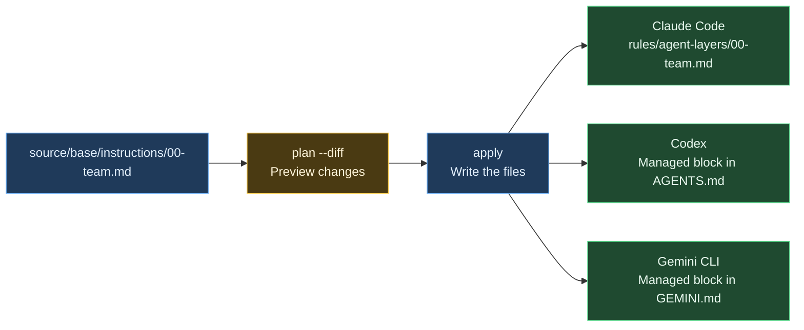

# Update instructions for Claude Code, Codex and Gemini together

[한국어](SHARED-RULES.ko.md)

If you keep a copy of the same working rules in Claude Code, Codex and Gemini CLI, each rule change means finding and editing three files. With agent-layers, you edit one Markdown source and run `apply` to update each tool's instruction file.

This walkthrough lets you check **one rule change → three tools updated → an existing note preserved**. You can run it without an AI account or an API key.

Written and verified: 2026-11-03

| Item | Details |
| --- | --- |
| Version | [agent-layers 0.1.6](https://www.npmjs.com/package/agent-layers/v/0.1.6) |
| Requirements | Node.js 18.17+, npm, Bash and standard Unix commands |
| Verified environment | Linux ARM64, Node.js 24.15.0 |
| Where files are written | `source/` and a temporary home named `home/`, inside a new temporary directory |
| References | [Beginner's guide](GUIDE.en.md), [project overview](../README.md) |

Run the commands below **in order, in the same Bash shell**. This walkthrough was verified on Linux. It has not been run on Windows, WSL or macOS.

| PART | What you will check |
| --- | --- |
| 1 | How one source becomes three tools' instruction files |
| 2 | Creating the demo directory and rules |
| 3 | Previewing, applying and changing a rule |
| 4 | What the results mean and how to start using your real setup |

---
---

# PART 1 — One place to edit



For Codex and Gemini, agent-layers updates only its managed block. For Claude Code, it creates a dedicated rule file.

Every command that checks or applies settings in this walkthrough includes `--home`. It targets the new temporary home instead of your usual home configuration.

---
---

# PART 2 — Set up the demo

If agent-layers is not installed, install the version used in this walkthrough:

```sh
npm install --global agent-layers@0.1.6
```

Check the installed version and create the demo directory:

```bash
agent-layers --version
AL_DEMO_ROOT="$(mktemp -d "${TMPDIR:-/tmp}/agent-layers-demo.XXXXXX")"
AL_DEMO_SOURCE="$AL_DEMO_ROOT/source"
AL_DEMO_HOME="$AL_DEMO_ROOT/home"
mkdir -p "$AL_DEMO_SOURCE/base/instructions" "$AL_DEMO_HOME/.codex"
printf 'Demo directory: %s\n' "$AL_DEMO_ROOT"
```

The targets are listed explicitly, so you can check file generation even if none of the three AI CLIs is installed.

```bash
cat > "$AL_DEMO_SOURCE/agent-layers.jsonc" <<'JSON'
{
  "version": 1,
  "name": "shared-rules-demo",
  "targets": ["claude", "codex", "gemini"]
}
JSON

cat > "$AL_DEMO_SOURCE/base/instructions/00-team.md" <<'MARKDOWN'
# Shared working rules

- After making changes, report what you changed and which verification commands you ran.
MARKDOWN

cat > "$AL_DEMO_HOME/.codex/AGENTS.md" <<'MARKDOWN'
# Notes for this PC

- Respond in Korean.
MARKDOWN
```

The last file represents an existing local note. You will check later that it stays intact.

---
---

# PART 3 — Apply the rules, then add one line

## 1. Preview before applying

```bash
agent-layers validate --source "$AL_DEMO_SOURCE" --home "$AL_DEMO_HOME"
agent-layers plan --diff --source "$AL_DEMO_SOURCE" --home "$AL_DEMO_HOME"
```

`plan` shows changes without writing the instructions. Its output includes the three instruction files and Gemini's `settings.json`. The Gemini setting tells it to read both `AGENTS.md` and `GEMINI.md`.

## 2. Apply to all three tools

```bash
agent-layers apply --yes --source "$AL_DEMO_SOURCE" --home "$AL_DEMO_HOME"
grep -nF 'After making changes, report what you changed and which verification commands you ran.' \
  "$AL_DEMO_HOME/.claude/rules/agent-layers/00-team.md" \
  "$AL_DEMO_HOME/.codex/AGENTS.md" \
  "$AL_DEMO_HOME/.gemini/GEMINI.md"
```

The same rule appears in all three files. `--yes` accepts the apply confirmation automatically; here, it applies only to the specified temporary home.

## 3. Edit only the source

```bash
cat >> "$AL_DEMO_SOURCE/base/instructions/00-team.md" <<'MARKDOWN'
- Explain why a new dependency is needed before adding it.
MARKDOWN

agent-layers plan --diff --source "$AL_DEMO_SOURCE" --home "$AL_DEMO_HOME"
agent-layers apply --yes --source "$AL_DEMO_SOURCE" --home "$AL_DEMO_HOME"
grep -nF 'Explain why a new dependency is needed before adding it.' \
  "$AL_DEMO_HOME/.claude/rules/agent-layers/00-team.md" \
  "$AL_DEMO_HOME/.codex/AGENTS.md" \
  "$AL_DEMO_HOME/.gemini/GEMINI.md"
```

All three files now contain the new rule, without editing them separately.

## 4. Check the existing note and remaining changes

```bash
grep -nF 'Respond in Korean.' "$AL_DEMO_HOME/.codex/AGENTS.md"
agent-layers plan --source "$AL_DEMO_SOURCE" --home "$AL_DEMO_HOME"
```

The existing note should appear, and the final plan should say `4 unchanged`. There are no further changes to apply to the three instruction files or the Gemini setting.

---
---

# PART 4 — What was verified

| Check | Expected result |
| --- | --- |
| First apply | The shared rule appears in all three instruction files |
| Add one line to the source | The new rule appears in all three files |
| Existing Codex note | The note outside the managed block is preserved |
| Plan again | `4 unchanged` |

These results were verified on 2026-11-03 using the npm-installed agent-layers 0.1.6 on Linux ARM64 with Node.js 24.15.0. The demo commands do not invoke an AI CLI. They check file creation, updates and preservation; they do not measure how well an AI follows the rules or whether it saves tokens.

The demo files remain in the `$AL_DEMO_ROOT` directory printed at the start. You can delete that demo directory after inspecting the results.

To use agent-layers with your real setup, follow [PART 2, “First install” in the guide](GUIDE.en.md#part-2--first-install). Keeping the rule source in your own Git repository lets you bring the same settings to another machine. The `source/` directory in this walkthrough only demonstrates the layout; the commands do not initialize Git or push anything to a remote.
