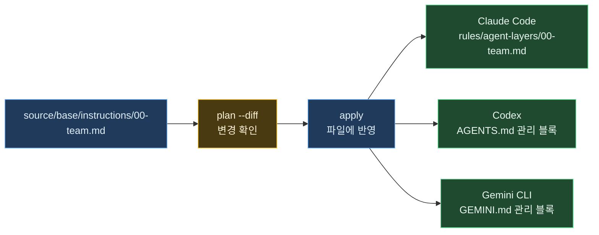

# Claude Code·Codex·Gemini 지침을 한 번에 바꾸기

같은 작업 규칙을 Claude Code, Codex, Gemini CLI에 각각 복사해 두면, 규칙을 바꿀 때마다 세 파일을 찾아 고쳐야 합니다. agent-layers에서는 Markdown 원본 하나를 고치고 `apply`를 실행하면 각 도구의 지침 파일이 함께 바뀝니다.

이 예제에서는 **규칙 한 곳 수정 → 세 도구에 반영 → 기존 메모 보존**을 직접 확인합니다. AI 계정이나 API 키 없이 실행할 수 있습니다.

작성일·검증 기준일: 2026-11-03

| 항목 | 내용 |
| --- | --- |
| 기준 버전 | [agent-layers 0.1.6](https://www.npmjs.com/package/agent-layers/v/0.1.6) |
| 준비물 | Node.js 18.17 이상, npm, Bash와 기본 Unix 명령 |
| 예제 실행 환경 | Linux ARM64, Node.js 24.15.0 |
| 파일을 쓰는 위치 | 새 임시 폴더의 `source/`와 가짜 홈 `home/` |
| 참고 문서 | [처음 쓰는 사람을 위한 가이드](GUIDE.ko.md), [프로젝트 소개](../README.ko.md) |

아래 명령은 **같은 Bash 셸에서 위에서부터** 실행합니다. 이번 예제는 Linux에서 검증했으며, Windows·WSL·macOS에서의 실행은 확인하지 않았습니다.

| PART | 확인할 내용 |
| --- | --- |
| 1 | 한 원본이 세 도구의 파일이 되는 구조 |
| 2 | 실습 폴더와 규칙 만들기 |
| 3 | 미리 보기, 적용, 규칙 변경 |
| 4 | 결과의 의미와 실제 환경에서 시작하는 방법 |

---
---

# PART 1 — 수정할 곳은 하나



Codex와 Gemini 파일에서는 agent-layers가 관리하는 블록만 갱신합니다. Claude Code에는 agent-layers 전용 규칙 파일을 만듭니다.

이 예제에서 설정을 점검하거나 적용하는 모든 agent-layers 명령에는 `--home`을 붙입니다. 따라서 평소 사용하는 홈 설정 대신 새로 만든 가짜 홈을 대상으로 실행합니다.

---
---

# PART 2 — 실습 준비

아직 설치하지 않았다면 다음 명령으로 예제와 같은 버전을 설치합니다.

```sh
npm install --global agent-layers@0.1.6
```

설치된 버전을 확인하고 실습 폴더를 만듭니다.

```bash
agent-layers --version
AL_DEMO_ROOT="$(mktemp -d "${TMPDIR:-/tmp}/agent-layers-demo.XXXXXX")"
AL_DEMO_SOURCE="$AL_DEMO_ROOT/source"
AL_DEMO_HOME="$AL_DEMO_ROOT/home"
mkdir -p "$AL_DEMO_SOURCE/base/instructions" "$AL_DEMO_HOME/.codex"
printf '실습 폴더: %s\n' "$AL_DEMO_ROOT"
```

대상을 명시했으므로 세 AI CLI가 설치되어 있지 않아도 파일 생성 과정을 확인할 수 있습니다.

```bash
cat > "$AL_DEMO_SOURCE/agent-layers.jsonc" <<'JSON'
{
  "version": 1,
  "name": "shared-rules-demo",
  "targets": ["claude", "codex", "gemini"]
}
JSON

cat > "$AL_DEMO_SOURCE/base/instructions/00-team.md" <<'MARKDOWN'
# 공통 작업 규칙

- 변경을 마치면 수정한 내용과 실행한 검증 명령을 함께 보고합니다.
MARKDOWN

cat > "$AL_DEMO_HOME/.codex/AGENTS.md" <<'MARKDOWN'
# 이 PC에만 둔 메모

- 답변은 한국어로 작성합니다.
MARKDOWN
```

마지막 파일은 기존 설정이 있는 상황을 재현하기 위한 메모입니다. 뒤에서 이 내용이 그대로 남는지 확인합니다.

---
---

# PART 3 — 적용하고 한 줄 바꾸기

## 1. 적용 전에 확인하기

```bash
agent-layers validate --source "$AL_DEMO_SOURCE" --home "$AL_DEMO_HOME"
agent-layers plan --diff --source "$AL_DEMO_SOURCE" --home "$AL_DEMO_HOME"
```

`plan`은 지침을 쓰지 않고 변경 내용을 보여 줍니다. 출력에는 세 도구의 지침과 Gemini의 `settings.json`이 포함됩니다. Gemini 설정은 `AGENTS.md`와 `GEMINI.md`를 읽도록 지정하는 보조 설정입니다.

## 2. 세 도구에 반영하기

```bash
agent-layers apply --yes --source "$AL_DEMO_SOURCE" --home "$AL_DEMO_HOME"
grep -nF '변경을 마치면 수정한 내용과 실행한 검증 명령을 함께 보고합니다.' \
  "$AL_DEMO_HOME/.claude/rules/agent-layers/00-team.md" \
  "$AL_DEMO_HOME/.codex/AGENTS.md" \
  "$AL_DEMO_HOME/.gemini/GEMINI.md"
```

세 파일에서 같은 규칙이 나옵니다. `--yes`는 적용 확인에 자동으로 동의하는 옵션이며, 여기서는 명시한 가짜 홈에만 적용합니다.

## 3. 원본 한 곳만 고치기

```bash
cat >> "$AL_DEMO_SOURCE/base/instructions/00-team.md" <<'MARKDOWN'
- 새 의존성을 추가하기 전에 필요성을 설명합니다.
MARKDOWN

agent-layers plan --diff --source "$AL_DEMO_SOURCE" --home "$AL_DEMO_HOME"
agent-layers apply --yes --source "$AL_DEMO_SOURCE" --home "$AL_DEMO_HOME"
grep -nF '새 의존성을 추가하기 전에 필요성을 설명합니다.' \
  "$AL_DEMO_HOME/.claude/rules/agent-layers/00-team.md" \
  "$AL_DEMO_HOME/.codex/AGENTS.md" \
  "$AL_DEMO_HOME/.gemini/GEMINI.md"
```

세 도구의 파일을 각각 고치지 않아도 새 규칙이 모두 반영됩니다.

## 4. 기존 메모와 남은 변경 확인하기

```bash
grep -nF '답변은 한국어로 작성합니다.' "$AL_DEMO_HOME/.codex/AGENTS.md"
agent-layers plan --source "$AL_DEMO_SOURCE" --home "$AL_DEMO_HOME"
```

기존 메모가 출력되고 마지막 계획에는 `4 unchanged`가 나와야 합니다. 세 지침 파일과 Gemini 보조 설정에 더 적용할 변경이 없다는 뜻입니다.

---
---

# PART 4 — 무엇을 확인했는가

| 확인 항목 | 기대 결과 |
| --- | --- |
| 처음 적용 | 공통 규칙이 세 도구의 지침 파일에 들어감 |
| 원본 한 줄 추가 | 추가한 규칙이 세 파일에 모두 들어감 |
| Codex 기존 메모 | 관리 블록 밖의 메모가 그대로 남음 |
| 다시 계획 확인 | `4 unchanged` |

2026-11-03에 npm으로 설치한 agent-layers 0.1.6을 Linux ARM64, Node.js 24.15.0에서 실행해 위 결과를 확인했습니다. 실습 명령은 AI CLI를 호출하지 않습니다. 확인한 범위는 설정 파일의 생성·갱신·보존이며, AI가 규칙을 얼마나 잘 따르는지나 토큰 절감 효과를 측정한 결과는 아닙니다.

실습 결과는 처음 출력한 `$AL_DEMO_ROOT` 폴더에 남습니다. 확인을 마치면 그 실습 폴더를 삭제하면 됩니다.

실제 환경에 도입하려면 [가이드 PART 2 「처음 설치」](GUIDE.ko.md#part-2--처음-설치)에서 설정 저장소를 만드는 절차를 따르십시오. 규칙 원본을 자신의 Git 저장소로 관리하면 다른 PC에서도 같은 내용을 가져와 적용할 수 있습니다. 이 실습의 `source/`는 구조를 보여 주는 폴더이며 Git 초기화나 원격 push는 하지 않습니다.
