# Manage and deploy role definitions, with optional workflow integration

[한국어](WORKFLOW-ROLES.ko.md)

“The implementer may edit only `src/`. The reviewer checks that tests have not been weakened. The auditor looks for unnecessary permissions.” You can store and share these role-specific standards just like code.

agent-layers keeps your team's rules and settings consistent across AI tools. Managing **Claude Code subagent definitions alongside shared instructions** extends that configuration management: store each role's rules, tools and model in the source, then deploy them. When your team's review standards change, edit the source and apply it again. This purpose is complete without workflow, and you can use the deployed definitions directly in Claude.

Use your AI tool's built-in task delegation when it is enough. Connecting the definitions to workflow's Planner, Coder, Reviewer and Auditor is an optional preview path for repeated tasks that need fixed checks, recorded results and resuming. Task length alone does not justify adding workflow.

Written and checked: 2026-11-03

| Item | Details |
| --- | --- |
| Versions | agent-layers 0.1.6, Claude Code 2.1.312 |
| Requirements | Node.js 18.17+, git 2.32+, Bash, agent-layers and Claude Code installed |
| Checked environment | Linux ARM64, Node.js 24.15.0 |
| Verification scope | Definition deployment and format validation, plus a workflow run with a mock provider |
| Real AI calls | The real Claude examples in this article (the optional session in PART 2 and workflow execution in PART 3) were not run. Both paths require authentication and consume usage when processing tasks |
| References | [Shared-rules walkthrough](SHARED-RULES.en.md), [workflow guide](GUIDE.en.md#running-a-task-with-workflow-preview), [example policy](../templates/workflow/policy.example.jsonc) |

| PART | Contents |
| --- | --- |
| 1 | Why manage role-specific rules, and how the pieces connect |
| 2 | Deploying four subagent definitions; optionally using them directly in Claude |
| 3 | Optional workflow integration: a policy for implementing a sum function |
| 4 | Verification results and supported scope |

---
---

# PART 1 — Configure who does the work and which rules they follow

| What you manage | What this example defines |
| --- | --- |
| Role-specific rules | Planner breaks down the task; Reviewer checks requirements and tests |
| Available tools | Coder can read and edit; Reviewer and Auditor have reading tools |
| Model choice | The definition's `model` field or `--model` in the role's CLI arguments |
| Completion criteria | Definition management ends after deployment and format validation; optional workflow execution requires tests, Reviewer and Auditor to pass |

```mermaid
flowchart LR
  S["Role definitions in Git<br/>base/agents/*.md"] --> A["agent-layers apply<br/>Deploy Claude definitions"]
  A -. "Optional workflow integration" .-> P["Planner<br/>al-wf-planner"]
  P --> C["Coder<br/>al-wf-coder"]
  C --> T["The program runs tests"]
  T --> R["Reviewer<br/>al-wf-reviewer"]
  R --> U["Auditor<br/>al-wf-auditor"]
  U --> D["Required criteria met<br/>SUCCEEDED"]
  style S fill:#1f3a5a,stroke:#63a8f0,color:#e3f0fd
  style A fill:#1f3a5a,stroke:#63a8f0,color:#e3f0fd
  style P fill:#4a3a12,stroke:#f5c542,color:#fdf3d8
  style C fill:#4a3a12,stroke:#f5c542,color:#fdf3d8
  style T fill:#1f4a30,stroke:#5ddb8f,color:#eafaf0
  style R fill:#4a3a12,stroke:#f5c542,color:#fdf3d8
  style U fill:#4a3a12,stroke:#f5c542,color:#fdf3d8
  style D fill:#1f4a30,stroke:#5ddb8f,color:#eafaf0
```



For optional workflow integration, use `provider.roleArgs` to make the connection. For example, passing `--agent al-wf-reviewer` for the Reviewer call makes Claude Code use that definition as the session's main agent. The option does not launch a child subagent. The same definition can also be used as a subagent in a regular Claude session. [Explicit agent selection in Claude Code](https://code.claude.com/docs/en/sub-agents#invoke-subagents-explicitly)

If you choose PART 3, workflow starts a separate CLI session for each role. That example does not repeatedly spawn child agents inside Claude, and the current workflow runs sequentially. Definition deployment in PART 2 does not start workflow; you can stop there or use Claude directly.

---
---

# PART 2 — Deploy role-specific rules

## Create the demo directory

Run the following commands in order in the same Bash shell. Each file heading below is a path relative to `$AL_WF_ROOT`.

```bash
AL_WF_ROOT="$(mktemp -d "${TMPDIR:-/tmp}/agent-layers-roles.XXXXXX")"
AL_WF_SOURCE="$AL_WF_ROOT/source"
AL_WF_HOME="$AL_WF_ROOT/home"
AL_WF_REPO="$AL_WF_ROOT/repo"
mkdir -p "$AL_WF_SOURCE/base/agents" "$AL_WF_HOME" "$AL_WF_REPO/src" "$AL_WF_REPO/test"
printf 'Demo directory: %s\n' "$AL_WF_ROOT"
```

Create the following five files. Put each role's essential rules directly in its definition. Do not assume another session's conversation or shared rules are inherited unchanged.

### source/agent-layers.jsonc

```json
{
  "version": 1,
  "name": "workflow-roles-demo",
  "targets": ["claude"]
}
```

### source/base/agents/al-wf-planner.md

```markdown
---
name: al-wf-planner
description: Plan small changes with explicit write paths and checks.
tools: Read, Grep, Glob
model: inherit
---
Break requirements into steps that can be executed independently.
Include write paths, check IDs and acceptance criteria for every step.
Do not edit files. Do not expand unclear requirements on your own.
When a workflow Request is present, follow its contract and JSON output format.
```

### source/base/agents/al-wf-coder.md

```markdown
---
name: al-wf-coder
description: Implement only the assigned change and preserve checks.
tools: Read, Edit, Write, Grep, Glob
model: inherit
---
Implement only within the assigned step's writePaths.
Do not change tests, policies or agent definitions to make the work pass.
Do not commit, push or install new dependencies.
When a workflow Request is present, follow its contract and JSON output format.
```

### source/base/agents/al-wf-reviewer.md

```markdown
---
name: al-wf-reviewer
description: Review requirements, edge cases and test integrity.
tools: Read, Grep, Glob
model: inherit
---
Compare the requirements with the actual changes without editing files.
Look for edge cases such as empty input and negative numbers, missing requirements and weakened tests.
For each finding, include the file path and the evidence you checked.
Do not report an item as passed if you have not verified it.
When a workflow Request is present, follow its contract and JSON output format.
```

### source/base/agents/al-wf-auditor.md

```markdown
---
name: al-wf-auditor
description: Audit scope, permissions and secret handling without edits.
tools: Read, Grep, Glob
model: inherit
---
Check the scope and permissions of the final changes without editing files.
Check for stored secrets, unnecessary network access and changes to protected paths.
Separate evidence from unverified items. Do not print raw secrets.
When a workflow Request is present, follow its contract and JSON output format.
```

`model: inherit` uses the model selected for the Claude session. You can change it per role, for example to `model: haiku`. Available models and the final selection depend on your Claude Code account and organization policies. Claude interprets `tools` and `model`; agent-layers deploys the definition unchanged. [Claude Code definition fields](https://code.claude.com/docs/en/sub-agents#frontmatter-reference)

## Apply to a temporary home and validate the format

```bash
agent-layers validate --source "$AL_WF_SOURCE" --home "$AL_WF_HOME"
agent-layers plan --diff --source "$AL_WF_SOURCE" --home "$AL_WF_HOME"
agent-layers apply --yes --source "$AL_WF_SOURCE" --home "$AL_WF_HOME"
CLAUDE_CONFIG_DIR="$AL_WF_HOME/.claude" claude plugin validate "$AL_WF_HOME/.claude/agents"
```

The four definitions appear in `$AL_WF_HOME/.claude/agents/`. This stage does not call an AI model. `plugin validate` checks the definition files' format; it does not verify that a model follows their rules.

**The four definitions have now been deployed and format-checked, completing the definition-management goal. You can stop here.** Neither Claude execution nor PART 3 is required to finish deployment.

## Optional: use a deployed definition directly in Claude

This path uses Claude's built-in agent selection without workflow. It does not require PART 3's policy, sum function or demo repository commit. In the same Bash shell, set `AL_WF_PROJECT` to the actual project folder you want to review, then change to that folder. Replace the placeholder path below before running it; `$AL_WF_REPO` is the separate sum demo, not your existing project.

```bash
AL_WF_PROJECT="/path/to/your/project"
cd "$AL_WF_PROJECT"
```

Authenticate in the same configuration directory that contains the deployed definitions. This starts Claude's official login flow; do not put credentials in the source files.

```sh
CLAUDE_CONFIG_DIR="$AL_WF_HOME/.claude" claude auth login
```

The next command starts a real Claude session. Asking it to review the project calls AI and consumes your account's usage. `--agent` selects `al-wf-reviewer` as that session's main agent; it does not launch a child subagent.

```sh
CLAUDE_CONFIG_DIR="$AL_WF_HOME/.claude" claude --agent al-wf-reviewer
```

Previously checked Claude Code 2.1.312 command help documents `auth login` and `--agent`. This example's actual Claude behavior has not been verified. The command-help evidence does not establish review quality, execution time or token savings.

---
---

# PART 3 — Optional: connect the definitions to workflow roles

Continue only if you want repeated tasks to follow fixed checks, recorded results and a resumable procedure through workflow (preview). PART 2 already completed definition deployment. The sum example and policy below are needed only for this optional workflow demonstration.

## Prepare a small implementation goal and fixed tests

Create these four files under `$AL_WF_ROOT` too. Keep the goal and policy outside the target `repo/` directory.

### repo/src/sum.cjs

```javascript
module.exports = function sum(values) {
  throw new Error('Not implemented');
};
```

### repo/test/sum.test.cjs

```javascript
const test = require('node:test');
const assert = require('node:assert/strict');
const sum = require('../src/sum.cjs');

test('adds positive numbers', () => {
  assert.equal(sum([1, 2, 3]), 6);
});
test('empty input returns zero', () => {
  assert.equal(sum([]), 0);
});
test('adds negative numbers', () => {
  assert.equal(sum([-3, 1, 2]), 0);
});
```

### goal.md

```markdown
Implement sum(values) in src/sum.cjs.
The input is an array of finite numbers; return their sum.
An empty array must return 0, and negative numbers must be supported.
Use one Coder step, with src/sum.cjs in writePaths and unit in checkIds.
Do not change existing tests or agent definitions. Do not add external packages.
```

### policy.jsonc

```json
{
  "schemaVersion": 1,
  "provider": {
    "command": "claude",
    "args": ["-p", "--output-format", "text", "--agent", "al-wf-coder", "--permission-mode", "acceptEdits", "--tools", "Read,Edit,Write,Grep,Glob"],
    "roleArgs": {
      "planner": ["-p", "--output-format", "text", "--agent", "al-wf-planner", "--tools", "Read,Grep,Glob"],
      "coder": ["-p", "--output-format", "text", "--agent", "al-wf-coder", "--permission-mode", "acceptEdits", "--tools", "Read,Edit,Write,Grep,Glob"],
      "reviewer": ["-p", "--output-format", "text", "--agent", "al-wf-reviewer", "--tools", "Read,Grep,Glob"],
      "auditor": ["-p", "--output-format", "text", "--agent", "al-wf-auditor", "--tools", "Read,Grep,Glob"]
    },
    "env": ["CLAUDE_CONFIG_DIR"]
  },
  "limits": {
    "maxSteps": 1,
    "maxAgentCalls": 4,
    "maxPlanRepairs": 0,
    "maxRepairAttempts": 0,
    "maxTransportRetries": 0,
    "stepTimeoutSeconds": 180,
    "runTimeoutSeconds": 900
  },
  "allowedWritePaths": ["src"],
  "protectedPaths": ["test", ".claude"],
  "checks": [
    { "id": "unit", "command": "node", "args": ["--test", "test/sum.test.cjs"], "timeout": 30, "inputs": ["test"], "baseline": "fail" }
  ],
  "requiredChecks": ["unit"],
  "requiredRoles": ["reviewer", "auditor"]
}
```

`roleArgs` is **the complete argument list for that role**, not something appended to the shared `args`. Include common options such as `-p` in each list. To request a different model for a role, add `"--model", "model-name"` to its list. This is a setting sent to the CLI, not proof of which model actually responds.

`baseline: "fail"` means the tests must fail before implementation. The same tests must pass after the Coder finishes. `inputs` protects the existing test files. Workflow can also request repairs after failed checks, but this example sets all retries to 0 to keep the call limit at four.

## Prepare the original repository

```bash
git -C "$AL_WF_REPO" init
git -C "$AL_WF_REPO" add src/sum.cjs test/sum.test.cjs
git -C "$AL_WF_REPO" -c user.name='Workflow Demo' -c user.email='demo@example.invalid' commit -m 'test: add sum fixture'
```

This commit establishes the demo repository's starting state. It does not create a remote repository or push anything.

## When you want to run a real AI

The following is an **optional stage that consumes real AI usage**. When preparing this article, we verified the workflow by replacing the provider with a mock; we did not check actual Claude responses.

First, authenticate using the demo's Claude configuration directory. The command below starts Claude's official login flow. Do not put credentials in the goal or policy file.

```sh
CLAUDE_CONFIG_DIR="$AL_WF_HOME/.claude" claude auth login
```

The execution commands below ask for confirmation before starting. Replace `<run-id>` with the ID printed by `plan`.

```sh
CLAUDE_CONFIG_DIR="$AL_WF_HOME/.claude" agent-layers workflow plan --goal-file "$AL_WF_ROOT/goal.md" --config "$AL_WF_ROOT/policy.jsonc" --path "$AL_WF_REPO" --home "$AL_WF_HOME"
agent-layers workflow validate <run-id> --home "$AL_WF_HOME"
CLAUDE_CONFIG_DIR="$AL_WF_HOME/.claude" agent-layers workflow run <run-id> --path "$AL_WF_REPO" --home "$AL_WF_HOME"
agent-layers workflow report <run-id> --home "$AL_WF_HOME"
```

`--home` changes where agent-layers stores state and worktrees. It does not change the child AI CLI's configuration directory. That is why this example sets `CLAUDE_CONFIG_DIR` separately and includes its name in `provider.env`.

After completion, inspect the implementation and check results in the worktree shown by `report`. Changes stay in that worktree and are not merged into the original repository automatically. `maxAgentCalls: 4` limits CLI invocations, not the model requests, tokens or cost within each invocation.

---
---

# PART 4 — Results and supported scope

| Item | What was checked |
| --- | --- |
| Definition deployment | All four files retained their instructions, tool lists and model fields |
| Claude definition format | Passed `plugin validate` with Claude Code 2.1.312 |
| Workflow role selection | Four mock calls received the expected `--agent` arguments for Planner, Coder, Reviewer and Auditor |
| Required checks and completion | Exit code 1 before implementation, three tests passed afterward, final status `SUCCEEDED` |
| Original files | The original repository and existing test files remained unchanged |
| Real AI role execution | Not run, including the direct Claude path in PART 2 |
| Actual response models and token efficiency | Not measured |

The mock provider returns a predefined plan, implementation and review responses. These results show that role routing and workflow checks worked. They do not show that Claude read and correctly followed the example rules.

The benefit is that you can reuse both the configuration source and its role assignments. For example, add “Check public API compatibility” to the Reviewer and deploy it again: subsequent runs selecting that role can use the updated definition. Do not change definitions during a run. For reproducibility, also record the commit of the setup repository you used.

Native subagent deployment from `base/agents/*.md` currently targets **Claude Code**. The same definitions are not automatically applied to every tool, including Codex. Workflow itself can use another CLI selected in its policy, but you must use that CLI's role-specific options.

Workflow is a preview feature. It checks path violations after calls finish and is not an OS sandbox. `SUCCEEDED` means the configured checks and review criteria passed. See [“What is not guaranteed” in the guide](GUIDE.en.md#what-is-not-guaranteed) for the remaining limits, including isolation and process cleanup.

## Mixed CLI assignments (schema v2)

Role definitions distributed to Claude are separate from task-level CLI assignments. With the optional v2 policy, Claude can plan and audit while Codex, Gemini and Kimi handle different coder steps. Each is a separate CLI session selected by a fixed plan; this does not register other products as native Claude subagents. Execution is sequential. See [task-level assignments](GUIDE.en.md#task-level-ai-assignments-schema-v2) and [the v2 policy example](../templates/workflow/policy.multi-agent.example.jsonc). Set model ids and permissions first. V1 policies and runs are preserved. Only fake CLI routing/recovery is verified; real mixed inference remains untested.
