# 서브에이전트의 규칙까지 관리하고 workflow에 연결하기

“구현 담당은 `src/`만 고치고, 검토 담당은 테스트가 약해지지 않았는지 확인하고, 감사 담당은 불필요한 권한을 찾는다.” 이런 역할별 기준도 코드처럼 저장하고 공유할 수 있습니다.

agent-layers는 **공통 지침뿐 아니라 Claude Code의 서브에이전트 정의도 설정 원본으로 관리**합니다. 역할마다 규칙·사용 도구·모델을 정해 배포하고, workflow의 Planner·Coder·Reviewer·Auditor에 해당 정의를 연결할 수 있습니다. 팀의 검토 기준을 바꿀 때는 원본을 수정해 다시 적용합니다.

작성일·확인 기준일: 2026-11-03

| 항목 | 내용 |
| --- | --- |
| 기준 버전 | agent-layers 0.1.6, Claude Code 2.1.312 |
| 준비물 | Node.js 18.17 이상, git 2.32 이상, Bash, 설치된 agent-layers와 Claude Code |
| 확인 환경 | Linux ARM64, Node.js 24.15.0 |
| 검증 범위 | 정의 배포·형식 검사와 모의 공급자를 사용한 workflow 실행 |
| 실제 AI 호출 | 이 글 작성 시 실행하지 않음. PART 3의 실제 실행에는 인증과 사용량이 필요 |
| 참고 | [공통 지침 예제](SHARED-RULES.ko.md), [workflow 가이드](GUIDE.ko.md#workflow로-작업-실행하기-preview), [정책 예시](../templates/workflow/policy.example.jsonc) |

| PART | 내용 |
| --- | --- |
| 1 | 역할별 규칙을 관리하는 이점과 연결 구조 |
| 2 | 서브에이전트 정의 4개를 가짜 홈에 배포 |
| 3 | 합계 함수 구현을 workflow로 실행하는 정책 |
| 4 | 검증 결과와 지원 범위 |

---
---

# PART 1 — 누가 어떤 기준으로 일할지도 설정한다

| 관리 대상 | 예제에서 정하는 내용 |
| --- | --- |
| 역할별 규칙 | Planner는 작업 분해, Reviewer는 요구사항·테스트 검토 |
| 사용할 도구 | Coder는 읽기·편집, Reviewer와 Auditor는 읽기 도구 |
| 모델 선택 | 정의의 `model` 또는 역할별 CLI 인자의 `--model` |
| 완료 조건 | 필수 테스트와 Reviewer·Auditor 검토 통과 |

```mermaid
flowchart LR
  S["Git으로 관리하는 역할 정의<br/>base/agents/*.md"] --> A["agent-layers apply<br/>Claude 정의 배포"]
  A --> P["Planner<br/>al-wf-planner"]
  P --> C["Coder<br/>al-wf-coder"]
  C --> T["프로그램이 테스트 실행"]
  T --> R["Reviewer<br/>al-wf-reviewer"]
  R --> U["Auditor<br/>al-wf-auditor"]
  U --> D["필수 조건 충족 시<br/>SUCCEEDED"]
  style S fill:#1f3a5a,stroke:#63a8f0,color:#e3f0fd
  style A fill:#1f3a5a,stroke:#63a8f0,color:#e3f0fd
  style P fill:#4a3a12,stroke:#f5c542,color:#fdf3d8
  style C fill:#4a3a12,stroke:#f5c542,color:#fdf3d8
  style T fill:#1f4a30,stroke:#5ddb8f,color:#eafaf0
  style R fill:#4a3a12,stroke:#f5c542,color:#fdf3d8
  style U fill:#4a3a12,stroke:#f5c542,color:#fdf3d8
  style D fill:#1f4a30,stroke:#5ddb8f,color:#eafaf0
```



연결에는 `provider.roleArgs`를 사용합니다. 예를 들어 Reviewer 호출 인자에 `--agent al-wf-reviewer`를 지정하면, Claude Code가 그 정의를 해당 세션의 주 에이전트로 사용합니다. 같은 정의는 일반 Claude 세션의 서브에이전트로도 사용할 수 있습니다. [Claude Code의 명시적 에이전트 선택](https://code.claude.com/docs/en/sub-agents#invoke-subagents-explicitly)

workflow는 역할마다 별도 CLI 세션을 실행합니다. 이 예제는 Claude 내부에서 자식 에이전트를 계속 생성하는 구성이 아니며, 현재 workflow는 순차 실행합니다. **서브에이전트 정의의 배포와 workflow의 실행 관리를 연결하는 예제**입니다.

---
---

# PART 2 — 역할별 규칙을 배포한다

## 실습 폴더 만들기

아래 명령은 같은 Bash 셸에서 순서대로 실행합니다. 각 파일 제목의 경로는 `$AL_WF_ROOT`를 기준으로 합니다.

```bash
AL_WF_ROOT="$(mktemp -d "${TMPDIR:-/tmp}/agent-layers-roles.XXXXXX")"
AL_WF_SOURCE="$AL_WF_ROOT/source"
AL_WF_HOME="$AL_WF_ROOT/home"
AL_WF_REPO="$AL_WF_ROOT/repo"
mkdir -p "$AL_WF_SOURCE/base/agents" "$AL_WF_HOME" "$AL_WF_REPO/src" "$AL_WF_REPO/test"
printf '실습 폴더: %s\n' "$AL_WF_ROOT"
```

다음 다섯 파일을 만듭니다. 정의 본문에는 각 역할이 꼭 지킬 규칙을 직접 적습니다. 다른 세션의 대화나 공통 규칙이 그대로 상속된다고 가정하지 않습니다.

### source/agent-layers.jsonc

```json
{
  "version": 1,
  "name": "workflow-roles-demo",
  "targets": ["claude"]
}
```

### source/base/agents/al-wf-planner.md

```markdown
---
name: al-wf-planner
description: Plan small changes with explicit write paths and checks.
tools: Read, Grep, Glob
model: inherit
---
요구사항을 독립적으로 실행할 수 있는 단계로 나눕니다.
각 단계에 수정 경로, 검사 ID, 완료 조건을 빠짐없이 적습니다.
파일을 고치지 않습니다. 불명확한 요구를 임의로 넓히지 않습니다.
workflow Request가 있으면 그 요청의 계약과 출력 JSON 형식을 따릅니다.
```

### source/base/agents/al-wf-coder.md

```markdown
---
name: al-wf-coder
description: Implement only the assigned change and preserve checks.
tools: Read, Edit, Write, Grep, Glob
model: inherit
---
배정된 단계의 writePaths 안에서만 구현합니다.
테스트·정책·에이전트 정의를 고쳐 성공으로 만들지 않습니다.
커밋, push, 새 의존성 설치는 하지 않습니다.
workflow Request가 있으면 그 요청의 계약과 출력 JSON 형식을 따릅니다.
```

### source/base/agents/al-wf-reviewer.md

```markdown
---
name: al-wf-reviewer
description: Review requirements, edge cases and test integrity.
tools: Read, Grep, Glob
model: inherit
---
파일을 고치지 않고 요구사항과 실제 변경 내용을 비교합니다.
빈 입력과 음수 같은 경계 조건, 빠진 요구사항, 약해진 테스트를 찾습니다.
문제를 지적할 때는 파일 경로와 확인한 근거를 함께 적습니다.
직접 확인하지 못한 항목을 통과했다고 보고하지 않습니다.
workflow Request가 있으면 그 요청의 계약과 출력 JSON 형식을 따릅니다.
```

### source/base/agents/al-wf-auditor.md

```markdown
---
name: al-wf-auditor
description: Audit scope, permissions and secret handling without edits.
tools: Read, Grep, Glob
model: inherit
---
파일을 고치지 않고 최종 변경의 범위와 권한을 점검합니다.
비밀값 저장, 불필요한 네트워크 접근, 보호 경로 수정 여부를 확인합니다.
증거와 미확인 사항을 구분합니다. 비밀값 원문을 출력하지 않습니다.
workflow Request가 있으면 그 요청의 계약과 출력 JSON 형식을 따릅니다.
```

`model: inherit`는 Claude가 선택한 세션 모델을 사용하게 합니다. 역할마다 `model: haiku`처럼 바꿀 수도 있습니다. 사용할 수 있는 모델과 최종 선택은 Claude Code의 계정·조직 정책에 따릅니다. `tools`와 `model`은 Claude가 해석하고, agent-layers는 정의를 원문 그대로 배포합니다. [Claude Code의 정의 필드](https://code.claude.com/docs/en/sub-agents#frontmatter-reference)

## 가짜 홈에 적용하고 형식 확인하기

```bash
agent-layers validate --source "$AL_WF_SOURCE" --home "$AL_WF_HOME"
agent-layers plan --diff --source "$AL_WF_SOURCE" --home "$AL_WF_HOME"
agent-layers apply --yes --source "$AL_WF_SOURCE" --home "$AL_WF_HOME"
CLAUDE_CONFIG_DIR="$AL_WF_HOME/.claude" claude plugin validate "$AL_WF_HOME/.claude/agents"
```

정의 네 개가 `$AL_WF_HOME/.claude/agents/`에 생성됩니다. 이 단계는 AI를 호출하지 않습니다. `plugin validate`는 정의 파일의 형식을 검사하며, 모델의 규칙 준수까지 검증하지는 않습니다.

---
---

# PART 3 — workflow 역할과 연결한다

## 작은 구현 목표와 고정 테스트 준비

다음 네 파일도 `$AL_WF_ROOT` 아래에 만듭니다. 목표와 정책은 작업 대상 `repo/` 밖에 둡니다.

### repo/src/sum.cjs

```javascript
module.exports = function sum(values) {
  throw new Error('Not implemented');
};
```

### repo/test/sum.test.cjs

```javascript
const test = require('node:test');
const assert = require('node:assert/strict');
const sum = require('../src/sum.cjs');

test('adds positive numbers', () => {
  assert.equal(sum([1, 2, 3]), 6);
});
test('empty input returns zero', () => {
  assert.equal(sum([]), 0);
});
test('adds negative numbers', () => {
  assert.equal(sum([-3, 1, 2]), 0);
});
```

### goal.md

```markdown
src/sum.cjs의 sum(values)를 구현합니다.
입력은 유한한 숫자로 이루어진 배열이며 합계를 반환해야 합니다.
빈 배열은 0을 반환하고 음수도 처리해야 합니다.
Coder 단계 하나만 사용하고 writePaths는 src/sum.cjs, checkIds는 unit으로 지정합니다.
기존 테스트와 에이전트 정의는 수정하지 않습니다. 외부 패키지는 추가하지 않습니다.
```

### policy.jsonc

```json
{
  "schemaVersion": 1,
  "provider": {
    "command": "claude",
    "args": ["-p", "--output-format", "text", "--agent", "al-wf-coder", "--permission-mode", "acceptEdits", "--tools", "Read,Edit,Write,Grep,Glob"],
    "roleArgs": {
      "planner": ["-p", "--output-format", "text", "--agent", "al-wf-planner", "--tools", "Read,Grep,Glob"],
      "coder": ["-p", "--output-format", "text", "--agent", "al-wf-coder", "--permission-mode", "acceptEdits", "--tools", "Read,Edit,Write,Grep,Glob"],
      "reviewer": ["-p", "--output-format", "text", "--agent", "al-wf-reviewer", "--tools", "Read,Grep,Glob"],
      "auditor": ["-p", "--output-format", "text", "--agent", "al-wf-auditor", "--tools", "Read,Grep,Glob"]
    },
    "env": ["CLAUDE_CONFIG_DIR"]
  },
  "limits": {
    "maxSteps": 1,
    "maxAgentCalls": 4,
    "maxPlanRepairs": 0,
    "maxRepairAttempts": 0,
    "maxTransportRetries": 0,
    "stepTimeoutSeconds": 180,
    "runTimeoutSeconds": 900
  },
  "allowedWritePaths": ["src"],
  "protectedPaths": ["test", ".claude"],
  "checks": [
    { "id": "unit", "command": "node", "args": ["--test", "test/sum.test.cjs"], "timeout": 30, "inputs": ["test"], "baseline": "fail" }
  ],
  "requiredChecks": ["unit"],
  "requiredRoles": ["reviewer", "auditor"]
}
```

`roleArgs`는 공통 `args`에 덧붙이는 값이 아니라 **그 역할의 전체 인자 목록**입니다. `-p` 같은 공통 옵션도 각 목록에 포함해야 합니다. 역할별로 다른 모델을 요청하려면 해당 목록에 `"--model", "모델 이름"`을 넣습니다. 이것은 CLI에 보낼 설정이며 실제 응답 모델의 증명은 아닙니다.

`baseline: "fail"`은 구현 전 테스트가 실패해야 한다는 뜻입니다. Coder가 끝난 뒤에는 같은 테스트가 통과해야 합니다. `inputs`는 기존 테스트 파일을 보호합니다. 검사 실패 시 수정을 요청하는 기능도 있지만, 이 예제는 호출을 네 번으로 제한하기 위해 모든 재시도를 0으로 둡니다.

## 원본 저장소 준비

```bash
git -C "$AL_WF_REPO" init
git -C "$AL_WF_REPO" add src/sum.cjs test/sum.test.cjs
git -C "$AL_WF_REPO" -c user.name='Workflow Demo' -c user.email='demo@example.invalid' commit -m 'test: add sum fixture'
```

이 커밋은 실습 저장소의 시작 상태를 만듭니다. 원격 저장소를 만들거나 push하지 않습니다.

## 실제 AI로 실행할 때

여기부터는 **실제 AI 사용량이 발생하는 선택 단계**입니다. 작성 시에는 아래 명령의 공급자를 모의 실행기로 바꿔 검증했으며 Claude의 실제 응답은 확인하지 않았습니다.

먼저 예제용 Claude 설정 폴더에서 인증합니다. 아래 명령은 Claude의 공식 로그인 절차를 시작합니다. 인증값을 목표나 정책 파일에 적지 않습니다.

```sh
CLAUDE_CONFIG_DIR="$AL_WF_HOME/.claude" claude auth login
```

다음 명령은 실행 전 확인을 받습니다. `plan`이 출력한 실행 ID를 `<run-id>`에 넣습니다.

```sh
CLAUDE_CONFIG_DIR="$AL_WF_HOME/.claude" agent-layers workflow plan --goal-file "$AL_WF_ROOT/goal.md" --config "$AL_WF_ROOT/policy.jsonc" --path "$AL_WF_REPO" --home "$AL_WF_HOME"
agent-layers workflow validate <run-id> --home "$AL_WF_HOME"
CLAUDE_CONFIG_DIR="$AL_WF_HOME/.claude" agent-layers workflow run <run-id> --path "$AL_WF_REPO" --home "$AL_WF_HOME"
agent-layers workflow report <run-id> --home "$AL_WF_HOME"
```

`--home`은 agent-layers의 상태와 worktree 위치를 바꿉니다. 자식 AI CLI의 설정 위치까지 바꾸지는 않으므로, 이 예제는 `CLAUDE_CONFIG_DIR`을 별도로 지정하고 `provider.env`에도 그 이름을 넣었습니다.

완료되면 `report`에 나온 worktree에서 구현과 검사 결과를 확인합니다. 변경은 그 worktree에 남으며 원본 저장소에 자동으로 병합되지 않습니다. `maxAgentCalls: 4`는 CLI 호출 횟수의 상한이고, 한 CLI 안의 모델 요청·토큰·금액 상한은 아닙니다.

---
---

# PART 4 — 확인한 결과와 적용 범위

| 항목 | 이번 확인 결과 |
| --- | --- |
| 역할 정의 배포 | 4개 파일의 본문·도구·모델 필드가 그대로 배포됨 |
| Claude 정의 형식 | Claude Code 2.1.312의 `plugin validate` 통과 |
| workflow 역할 선택 | 모의 호출 4회에서 Planner·Coder·Reviewer·Auditor의 `--agent` 인자 확인 |
| 필수 검사와 완료 | 구현 전 종료 코드 1, 구현 후 테스트 3개 통과, 최종 `SUCCEEDED` |
| 원본 보존 | 원본 저장소와 기존 테스트 파일의 내용 유지 |
| 실제 AI의 역할 수행 | 미실행 |
| 실제 모델과 토큰 효율 | 미측정 |

모의 공급자는 정해진 계획·구현·검토 응답을 돌려주는 실행기입니다. 이 결과는 역할 연결과 workflow의 검사 절차가 동작했다는 근거이며, Claude가 예제 규칙을 읽고 올바르게 수행했다는 근거는 아닙니다.

설정 원본과 역할 연결을 재사용할 수 있다는 점이 이 구성의 이점입니다. 예를 들어 Reviewer에 “공개 API 호환성을 확인한다”는 규칙을 추가하고 다시 배포하면, 같은 역할을 선택하는 다음 실행부터 갱신된 정의를 사용할 수 있습니다. 실행 중에는 정의를 바꾸지 말고, 재현이 필요하면 사용한 설정 저장소의 커밋도 함께 기록하십시오.

현재 `base/agents/*.md`의 네이티브 서브에이전트 배포 대상은 **Claude Code**입니다. Codex 등 모든 도구에 같은 정의가 자동으로 적용되는 것은 아닙니다. workflow 자체는 정책에서 선택한 다른 CLI도 사용할 수 있으며, 역할별 옵션은 그 CLI에 맞춰 지정해야 합니다.

workflow는 preview입니다. 경로 위반 검사는 호출 후 수행되며 OS 샌드박스가 아니고, `SUCCEEDED`는 정해 둔 검사·검토 조건을 통과했다는 뜻입니다. 격리·프로세스 정리 등 나머지 한계는 [가이드의 「보장하지 않는 범위」](GUIDE.ko.md#보장하지-않는-범위)를 확인하십시오.
