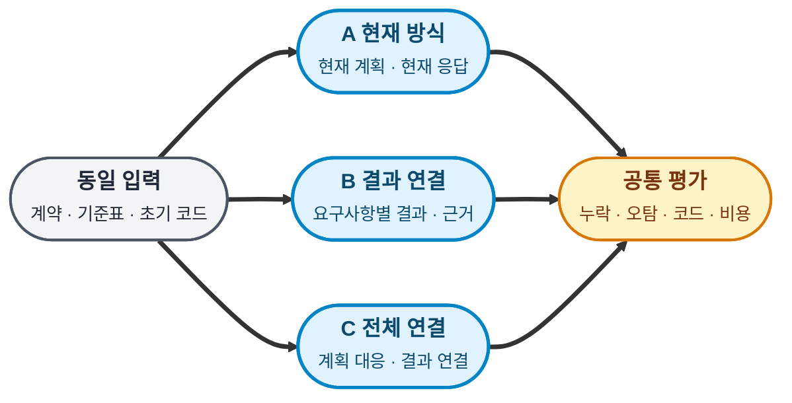

# Luna·Terra 요구사항 연결 방식 비교 시험안

- 저장소 사본 정리일: 2026-11-11 KST. 아래 외부 작업 기록은 이번 커밋에 포함하지 않는다. 해당 자료 없이 표본 준비·과거 실행 재검증을 완료한 것으로 판단하지 않는다.
- 검증 기록: validation-review-fixes.json의 sourceValidation은 이전 원본 문서 기준이고, repositoryValidation은 링크를 정리한 현재 저장소 사본 기준이다.
- 작성일·기준일: 2026-11-10 KST.
- 상태: **시험안 작성 완료. 표본·adapter·정책·실행 일정 파일은 아직 만들지 않았고 실제 AI 호출은 0회다.**
- 설계 계약: [SPEC.md](SPEC.md) 3~8절. 이 문서는 비교 방법과 판단 기준을 담당한다.
- 향후 동결할 제품 기준: `5f2ec4c4a72847cc7314e207ae5e9930deb0b9c3`. 실행 직전에 별도 사본과 버전을 검증한다.
- 요청 모델: `gpt-6-luna`, `gpt-6.1-terra`, reasoning `medium`. 현재 접근 가능성·가격을 새로 확인한 결과가 아니다.

| 근거 이름 | 위치 | 사용할 내용 |
|---|---|---|
| 연결 설계 | [SPEC.md](SPEC.md) | 3~8절 기준표·연결·호환성 |
| 기존 확대 시험안 | PLAN.md — 외부 작업 기록 `2026-11/2026-11-09/workflow-expanded-defect-test-plan/PLAN.md` | 6~9절 격리·비용·오탐·분모 구분 |
| 기존 과제 계약 | T1 — 외부 작업 기록 `2026-11/2026-11-09/workflow-expanded-defect-kit/contracts/T1.md`, T2 — 외부 작업 기록 `2026-11/2026-11-09/workflow-expanded-defect-kit/contracts/T2.md`, T3 v2 — 외부 작업 기록 `2026-11/2026-11-09/workflow-expanded-defect-kit/checks/luna-terra-live/contract-clarification/T3-v2.md` | 전제·거부 의무·API·변경 범위 |
| 기존 평가기 | evaluate.mjs — 외부 작업 기록 `2026-11/2026-11-09/workflow-expanded-defect-kit/evaluate.mjs`, evaluate-symbol.mjs — 외부 작업 기록 `2026-11/2026-11-09/workflow-expanded-defect-kit/checks/t3-symbol-input-fix/evaluate-symbol.mjs` | 고정 기능 검사와 Symbol 거부·허용 대조 |
| 실제 선행 결과 | T3 실행 기록 — 외부 작업 기록 `2026-11/2026-11-09/workflow-expanded-defect-kit/checks/t3-symbol-live/README.md` | 두 모델 각 5회·15/15. 신규 방식의 비교 결과로 합산하지 않음 |

| PART | 내용 |
|---|---|
| 1 | 3개 방식·가설·동일 조건 |
| 2 | 구현 과제·누락 표본·순서 |
| 3 | 예산·기록·중단 조건 |
| 4 | 지표·판정·준비 검증 |

---
---
# PART 1 — 비교 질문과 구성

## 1. 세 방식과 여섯 조합

| 방식 | 계획 | 작업·검토 응답 | 추가 형식 검사 | 확인하려는 차이 |
|---|---|---|---|---|
| A: 현재 방식 | 현재 Planner 형식 | 현재 summary 중심 결과 | 기존 validator | 기준 결과 |
| B: 결과 연결 | A와 같은 계획 지시·형식 | 요구사항별 결과·실행 주장·근거 참조 | 결과 trace의 ID·필수 행·참조 검사 | B−A: 응답과 후속 전달 보완의 효과 |
| C: 전체 연결 | 요구사항→단계·완료 기준·예정 검사를 연결 | B와 같은 결과 연결 | B 검사 + 계획 trace의 누락·ID·참조 검사 | C−B: 계획 연결과 계획 수락 조건을 더한 효과 |

Luna-A, Luna-B, Luna-C, Terra-A, Terra-B, Terra-C의 **6개 조합**으로 실행한다. 각 workflow의 Planner·두 Coder·Reviewer·Auditor는 모두 같은 모델이다. 혼합 모델이나 Sol 검토를 끼워 넣지 않는다.

C−B는 계획 프롬프트·출력·수락 검사라는 묶음의 차이다. 계획에 번호를 붙이는 행위만의 순수한 효과로 해석하지 않는다. B−A도 결과 envelope와 후속 문맥 전달의 추가 부담을 함께 측정한다.

## 2. 같은 정보와 달라지는 처리

모든 방식에 동일한 원문 계약과 동일한 요구사항 기준표를 제공한다. 원문에 없는 힌트·정답·Symbol 수정 코드는 어느 방식에도 추가하지 않는다. 기준표는 공개 의무의 번호·원문 연결만 담고 비공개 witness는 제외한다.

따라서 A는 **현재 계획·응답 프로토콜에 공통 기준표와 각 실행의 확정 계획 전체를 제공한 기준군**이다. 예전 실제 실행의 프롬프트와 바이트 단위로 동일한 대조군은 아니다. 예전 수치를 A 결과로 재사용하지 않는다. 기준표와 계획 전체 전달 자체의 효과는 세 방식에 공통이라 이번 비교로 분리되지 않는다.

| 공통 고정 항목 | 규칙 |
|---|---|
| 의미 정보 | 원문·기준표·초기 소스·공개 검사·정책·이전 단계 코드·외부 평가 기준 동일 |
| Planner | A/B의 최초 입력 템플릿 동일. C만 planTrace 출력·검사 조건 추가 |
| 확정 계획 전체 | 계획 저장 후 A/B/C의 Coder·Reviewer·Auditor 모두 SPEC 8절의 confirmedPlan을 같은 구조로 받음. 각 실행의 계획 내용은 다를 수 있음 |
| Coder·Reviewer·Auditor | B/C의 결과 trace 형식 동일. C는 실제 계획에서 생성된 planTrace도 받음 |
| 역할·권한 | 읽기 전용 Planner/Reviewer/Auditor, 지정 소스 두 파일만 Coder 쓰기 |
| 추론·호출 | 같은 모델 ID·medium·통신 재시도 0·독립 세션·동시 1 |
| 검사 | 동일한 고정 외부 검사와 공개 검사. 실패를 없애려고 테스트나 기준표를 바꾸지 않음 |
| 길이 | 같은 입력 한도 적용. 추가 출력·입력 바이트와 토큰을 실측하고 숨기지 않음 |
| 수동 개입 | 계획 안전 범위·정책만 동일 기준으로 확인. 한 군에만 요구사항 힌트나 정답 피드백을 주지 않음 |

계획 의미 채점은 관찰용으로 기록하고 그 피드백을 코드 생성 전에 전달하지 않는다. 개인 설정·권한·파괴적 작업 문제가 있으면 모든 방식에 같은 안전 중단 규칙을 적용한다. C의 필수 ID 누락 등 형식 검사만 해당 방식의 사전 수락 조건으로 작동한다. SPEC의 제품 도입안에서 다룬 사람의 의미 확인을 모든 시험 실행의 사전 수정 개입으로 넣지는 않는다. 그러면 계획 누락 효과를 가릴 수 있기 때문이다.

| 상태 | 요소 | 상세 |
|---|---|---|
| ⚫ 참조 `context` | 동일 입력 | 같은 과제·반복 블록 안에서 해시 동결 |
| 🔵 핵심 `core` | A/B/C | 각 모델에 모두 적용하고 결과를 섞지 않음 |
| 🟡 분기 `point` | 공통 평가 | 엔진 성공과 실제 요구사항 충족을 별도로 판단 |

---
---
# PART 2 — 과제와 표본

## 3. 구현 과제와 관찰 지점

| 과제 | 사용 계약 | 계획에서 확인할 의무 | 고정 외부 검사 |
|---|---|---|---|
| T1 페이지·피드 | 기존 T1 원문 그대로 | 경계 페이지, 값 0, 입력 불변, 허용 출력 필드, 연산 범위 | 기존 T1 평가를 그대로 실행. 정상 대조와 실제 총수를 준비 단계에 동결 |
| T2 캐시·재시도 | 기존 T2 원문 그대로 | TTL 시작·만료 경계, 실패 후 재시도, 이전 요청 완료와 무효화 순서, 주입 clock | 기존 T2 10개 검사 |
| T3 tenant·중복 요청 | 기존 T3 v2 원문 그대로 | tenant/key 구분, 0/-0, 동기 오류, enumerable Symbol, 중복 효과 방지 | 기존 10개 + Symbol 5개 = 15개 |

계약의 입력 전제 밖 동작을 필수 의무로 추가하지 않는다. T1에 다른 validated 계약을 섞지 않는다. 준비 단계에서 각 required 의무와 검사의 대응표를 만들되, 코드 검사만으로 확인할 수 없는 의무는 수동 판정 항목으로 명시한다.

이 세 과제는 기존 시험에서 사용한 사례이므로 완전히 새로운 일반화 표본이 아니다. 아직 보지 않은 과제에 대한 안정성은 별도 후속 시험 대상이다.

## 4. 통제된 검토 표본 9개

자연 실행에서 결함이 안 생기면 탐지 차이를 측정하기 어렵다. 구현 시험과 별도로 아래 9개 검토 패킷을 준비한다. 모두 재구성한 시험 자료로 표시하고 실제 workflow 기록으로 위장하지 않는다.

| 과제 | P: 계획 누락·코드는 정상 | I: 계획은 완전·구현 위반 | N: 정상 대조 |
|---|---|---|---|
| T1 | 출력 필드 제한을 계획에서 제거 | 계획에 명시된 입력 불변을 위반하는 구현 | 원문·계획·구현·근거가 일치 |
| T2 | 무효화 후 이전 요청 처리 의무를 계획에서 제거 | 완료 시각 기준 TTL 의무를 위반하는 구현 | 정상 비동기 순서와 근거 |
| T3 | enumerable Symbol 거부 의무를 계획에서 제거 | 계획과 달리 Object.keys로 Symbol을 허용 | 비열거·상속 Symbol 허용까지 지키는 구현 |

P 표본은 검사에 통과하는 정상 코드와 불완전한 계획을 결합한다. 정답은 **계획 누락 지적이며 코드 결함 지적은 아니다.** 번호만 빠진 사례와 의미가 빠진 사례를 혼동하지 않도록 원문 의미도 계획에서 제거한다. C의 planTrace도 해당 의무가 빠진 일관된 상태로 만든다.

I 표본은 모델 작성 요약에 잘못된 완료 주장을 넣되, 실제 검사의 실패 로그를 함께 제공한다. 서명·해시를 위조한 엔진 기록을 만들지 않는다. N 표본에서는 필수 수정 요구가 없어야 한다. 선택적 제안과 실제 오탐은 구분한다.

각 패킷의 코드·원문·계획·관측 로그는 모든 조합에 동일하게 제공한다. 방식별 응답 요구와 trace 표현만 달라진다. C의 계획 사전 차단 장치는 이 검토 패킷에서는 실행하지 않고, 불완전한 계획을 Reviewer가 탐지하는지 측정한다. 이 결과를 전체 workflow의 게이트 성능으로 합산하지 않는다.

모델별·방식별 Reviewer 1회로 각 패킷을 평가한다. 별도 Auditor 호출은 이 부시험에 없다. 실제 workflow의 Auditor는 모든 구현 시험에서 동일하게 유지한다. 구현과 검토 표본 사이에 응답을 재사용하지 않는다.

## 5. 반복·순서·입력 동결

| 단계 | 구성 | 역할 |
|---|---|---|
| 무추론 준비 | 정상·결함 대조, trace validator, 예산·보존 검사 | 실제 AI 없이 실행 준비 여부 판단 |
| 1차 파일럿 | 2모델 × 3방식 × 3과제 × 1회 = 18 workflow, 검토 54회 | 형식·도구 오류와 초기 효과 관찰 |
| 반복 확대 | 같은 구성의 반복 2회 추가 = 36 workflow | 총 54 workflow, 조합별 과제당 3회 확보 |

확대 총수 54에는 파일럿 18이 포함된다. 검토 54회는 파일럿에서 한 번 수행하고 반복 확대에서 재사용해 새 관측처럼 세지 않는다. 형식·과제·도구를 고친 뒤에는 버전을 나누고 기존 반복과 합산하지 않는다.

과제 인덱스 q=0,1,2, 반복 r=0,1,2에서 방식 순서는 `ABC`, `BCA`, `CAB` 중 `(q+r) mod 3`으로 고른다. 모델 선후에는 실행 위치가 아닌 **고정 방식 인덱스 m(A=0, B=1, C=2)**를 사용한다. 위치별 편중도 막기 위해 보정값 d는 q=0이고 r=1 또는 2이면 1, 나머지는 0으로 고정한다. `(q+r+m+d) mod 2`가 0이면 Luna→Terra, 1이면 Terra→Luna다. r=0이 파일럿이고 r=1,2가 추가 반복이다. 조기 중단이 있어도 뒤 일정의 q/r/m/d를 다시 매기지 않는다.

| 방식 | 파일럿 Luna 먼저 / Terra 먼저 | 확대 누계 Luna 먼저 / Terra 먼저 | 확대 누계의 방식 위치 1·2·3 |
|---|---|---|---|
| A | 2 / 1 | 5 / 4 | 각 3회 |
| B | 1 / 2 | 4 / 5 | 각 3회 |
| C | 2 / 1 | 5 / 4 | 각 3회 |
| 전체 | 5 / 4 | 14 / 13 | 방식별 균형 유지 |

방식마다 과제별 3회 반복에서도 모델 선후가 2/1 또는 1/2이며, 방식별 위치 각각에서도 선후 차이가 1 이하다. 홀수 회수의 차이 1은 남기되, 특정 방식에서 7/2로 치우치던 기존 식은 사용하지 않는다. 최종 일정 검사는 전체 합계와 함께 방식별·과제별·위치별 분포를 확인한다.

검토 패킷 9개의 이름·순서는 준비 단계에서 중립 ID와 seed `20261110`으로 동결한다. 6개 조합 순서의 회전으로 위치 편향을 줄이고 최종 일정표를 저장한다. 이 seed는 스케줄용이며 모델 생성의 재현 seed가 아니다. 준비 도구가 알고리즘·최종 순서·입력 해시를 저장해야 한다.

---
---
# PART 3 — 한도와 실행 기록

## 6. 호출 수와 비용

기본 workflow는 Planner 1 + Coder 2 + Reviewer 1 + Auditor 1 = 정상 5회다. 모든 방식에서 작업당 전체 최대 7회, 계획 수정 최대 1회, 대상별 수정 최대 1회, 통신 재시도 0을 적용한다. 전체 한도가 우선하므로 가능한 수정 한도를 모두 사용할 수 있다고 보장하지 않는다.

trace envelope·ID·참조 형식 실패는 이번 시험에서 adapter 오류로 중단하며 숨겨진 추가 수리 호출은 없다. 기존 엔진의 계획·코드 수정은 원래 한도 안에서만 수행한다. C의 계획 trace 누락은 Coder를 호출하기 전에 차단하며 형식 실패와 의미 누락을 각각 기록한다.

| 구간 | 정상 호출 산식 | 정상 호출 | 최대 호출 산식 | 최대 호출 |
|---|---|---:|---|---:|
| 파일럿 구현 | 18 × 5 | 90 | 18 × 7 | 126 |
| 검토 부시험 | 9 × 2 × 3 | 54 | 재시도 없이 54 | 54 |
| 파일럿 합계 | 90 + 54 | 144 | 126 + 54 | 180 |
| 확대 시 추가 구현 | 36 × 5 | 180 | 36 × 7 | 252 |
| 전체 누계 | 54 × 5 + 54 | 324 | 54 × 7 + 54 | 432 |

모든 수치는 **향후 실행 제안의 한도**이며 현재 승인받거나 호출한 수가 아니다. 파일럿 이후 확대는 결과를 보고 별도로 정한다. 호출 상한은 토큰·청구액 상한이 아니다. 가격과 사용 계정의 실제 과금 기준을 실행 전에 확인하고, 토큰 단가 환산 추정과 실제 청구액을 구분한다.

파일럿에서 일찍 차단된 실행도 원래 18개 분모에 남긴다. 호출을 적게 썼다는 이유만으로 개선으로 판단하지 않는다. 별도 ledger나 재실행으로 180/432 한도를 우회하지 않는다.

## 7. 실행·보존·재개 규칙

| 항목 | 규칙 |
|---|---|
| 실행 입력 | engine commit, 계약·기준표·정책·표본·프롬프트·adapter·검사 코드의 해시를 호출 전 동결 |
| 실행 식별 | experimentVersion/model/method/task/repeat/runId/callId로 기록. 성공·실패·무효 모두 보존 |
| 계획과 결과 연결 | 기준표 ID, 계획 단계, 원래 결과 해시, trace 해시, 검사 실행 ID, 코드 버전을 함께 저장 |
| 확정 계획 전달 | 원본 plan.json 전체, 현행 planHash, 파일 SHA-256, 실제 confirmedPlan 전달 해시를 runId/callId에 연결. 누락·불일치 시 호출 전 중단 |
| 사용량 | 실패·계획 수정·코드 수정 포함 모든 turn 사용량 집계. 누락 시 알려진 소계와 전체 미확인 분리 |
| 시간 | 준비·계획·구현·검토·감사·수동 판정·대기·총 경과 시간을 분리 |
| 문맥 | 작업별 독립 clone·별도 홈·새 세션. 다른 모델 결과·정답·과거 수정 사본 접근 금지 |
| 상태 보존 | 기존 시험 폴더는 읽기만 한다. 개인 설정과 원본 소스는 호출 전후 및 호출 사이 해시 대조 |
| 인증 | 지원되는 별도 홈 방식을 무추론으로 확인. 인증 값은 로그·문서·Git에 넣지 않고 임시 사본은 종료 후 제거 |
| 재개 | 같은 원문·정책·기준표·adapter·trace 해시를 만족할 때만 재개. 요구사항 변경은 새 계획 |
| 입력 한도 | prompt 전체 262144바이트, dependency·confirmedPlan 전체·추가 trace 문맥을 합쳐 65536바이트. 모든 방식에 동일하게 적용하며 초과 시 호출 전 중단하고 잘라 전달하지 않음 |
| 시간 한도 | AI 호출 420초, workflow 활동 1800초. 파일럿 실행 전 준비 도구에서 실제 강제 가능 여부 확인 |

보호 파일·개인 설정 변경, 기록 해시 불일치, 한도 초과 예약, 공통 실행기 결함은 남은 호출을 중단한다. 원인을 확인하기 전 재시도하거나 자동 원복하지 않는다. 모델별 형식 실패·검사 실패는 해당 실행 실패로 보존하고 다른 독립 실행은 공통 환경 이상이 없을 때만 계속한다.

---
---
# PART 4 — 판정과 준비 완료

## 8. 측정값과 분모

| 지표 | 정의·분모 |
|---|---|
| 계획 의미 누락 | 원문 required 의무 중 계획에 의미가 보존되지 않은 수 / required 의무 수. ID 존재율과 분리 |
| 구조 연결률 | 적법한 단계·응답·근거 참조가 모두 있는 의무 수 / 해당 방식에서 연결 의무가 있는 수. A는 해당 없음 |
| 의미 연결 정확도 | 연결했다고 주장한 행 중 원문·계획·실제 동작이 맞는 행 / 연결 주장 행. 표본만 검사하면 검사한 행 수도 표시 |
| 거짓 완료 | engine SUCCEEDED 또는 최종 Reviewer/Auditor의 전체 완료 주장과 달리 필수 외부 검사·보존·필수 의미 판정이 실패한 실행 수 / 전체 실행 수 |
| 실제 요구사항 충족 | 외부 검사·보존 조건·필수 수동 확인 모두 통과한 실행 수 / 전체 실행 수. 형식 중단·미실행도 분모 유지 |
| 계획 누락 탐지 | P 3표본 중 누락 위치·원문 의무를 맞게 지적한 수 / 3 |
| 구현 결함 탐지 | I 3표본 중 원인·재현·의무 위반을 맞게 지적한 수 / 3 |
| 정상 오탐 | N 3표본 중 근거 없는 필수 수정 요구가 있는 수 / 3. P/I의 추가 오탐도 별도로 집계 |
| 근거 없는 검증 주장 | 실제 기록에 없는 passed 주장 수 / 전체 검증 주장 수. 주장 0건은 비율 해당 없음이며 완료 성공 아님 |
| 형식 유효성 | 유효 결과 / 전체 시도. 무응답·타임아웃·trace 오류는 성공이나 오탐 없는 답으로 계산하지 않음 |
| 추가 부담 | 동일 모델·과제·반복의 호출·토큰·경과 시간·수동 개입 차이. 실패 실행 소모도 포함 |

자연 구현의 결함 수는 방식마다 다를 수 있으므로 Reviewer의 탐지 성능을 자연 실행 발견 건수만으로 비교하지 않는다. 동일 패킷 부시험을 따로 보고한다. 번호·형식·검사 통과로 의미 판단 전체를 자동화했다고 주장하지 않는다.

Coder의 completed는 현재 단계 범위에 대해서만 판정한다. 다른 단계에서 아직 구현하지 않은 의무 때문에 해당 Coder를 거짓 완료로 세지 않는다. 모든 최종 의무의 충족 판정은 마지막 코드와 최종 기록을 기준으로 한다.

P 표본에서 계획 누락을 지적한 것은 정탐이다. 정상 코드를 반드시 고치라고 요구하면 별도 오탐이다. I에서 같은 근본 원인을 여러 번 지적하면 한 건으로 센다. 계약 밖 의무 추가, 실행으로 반증된 지적, 미확인 지적, 선택적 제안을 구분한다.

판정자는 원문·실제 코드·재현을 보고 판정하며 모델명·실행 순서·비용을 가능한 한 가린다. trace 형식 때문에 방식은 완전히 숨길 수 없고, 한 담당자가 실행과 평가를 맡으면 부분 가림으로 기록한다. 사전 정답 밖 지적도 재현해 실제 문제면 신규 발견으로 남긴다. 추가 AI 채점은 기본 예산에 포함하지 않는다.

## 9. 채택·보류 기준

| 관찰 | 결론 |
|---|---|
| B가 A보다 누락·거짓 완료를 줄이고 오탐·최종 실패를 늘리지 않음 | 결과 연결을 해당 모델·과제의 후보로 유지하고 추가 부담을 비교 |
| C가 B보다 계획 누락·계획에서 비롯된 실패를 줄임 | 계획 연결 묶음의 추가 가치. 구조 게이트 차단과 의미 탐지의 기여를 분리해 보고 |
| 연결률만 높고 실제 성공·오탐이 같음 | 문서화 이득만 관찰. 실패 감소를 주장하지 않음 |
| C가 자주 차단하지만 최종 충족률은 떨어짐 | 조기 탐지와 형식 부담을 함께 보고 도입 보류 |
| 양쪽 모델 모두 차이가 없거나 표본이 작음 | 개선 근거 불충분. 관측 성공을 동등성 증명으로 해석하지 않음 |
| 한 모델에서만 이득 | 모델별 선택안. 모든 저렴한 모델에 일반화하지 않음 |
| 보호 위반·검사 약화·기록 오염 | 해당 시험 유효성 재검토. 높은 성공률로 상쇄하지 않음 |

파일럿 조합별 3실행은 선별 자료다. 반복 확대에서도 조합별 9실행이므로 큰 일반화는 피한다. 같은 과제 반복은 독립 프로젝트 9개가 아니다. 모델별·과제별 원값과 A/B/C 대응 차이, 반복별 일관성을 먼저 보고한다. 성공률·토큰을 임의 가중치로 합친 단일 점수는 만들지 않는다.

도입 후보의 실용적 이득 기준은 실행 전에 동결한다. 이 시험안의 제안은 **실제 누락 또는 거짓 완료가 줄고, 정상 오탐과 보호 위반이 증가하지 않으며, 같은 모델·과제의 중앙 토큰/시간 증가가 각각 25% 이내**인 경우다. 25%는 검증된 성능 기준이 아니라 운영상 허용 증가폭의 제안이다. 품질 차이가 없으면 비용 증가만으로 채택하지 않는다. 토큰·시간이 미확인이면 효율 채택 판정도 보류한다.

## 10. 외부 AI 없는 준비 검증

| 준비 대상 | 반드시 확인할 사례 |
|---|---|
| 기준표 | 중복·누락 ID, 잘못된 원문 인용, 의무의 의미 변경, 원문 업데이트 감지 |
| 계획 trace | 없는 단계·검사 ID, 누락 required, 금지 경로 배정, ID만 맞고 의미가 다른 계획 |
| 공통 계획 전달 | A/B/C의 모든 후속 역할에 전체 계획 제공, 단계별 instruction·배정·검사 누락 검출, 다른 runId·변경된 파일·잘못된 해시 거부. 아직 계획이 없는 Planner는 제외 |
| 결과 trace | 원래 결과와 trace의 stepId/attempt 불일치, 빠진 행, 같은 ID의 모순 주장, 미실행 검사 passed 주장 |
| 증거 연결 | 오래된 코드 해시, 다른 실행 로그, 변경된 선행 결과, 경로 이탈·symlink, 숨겨진 정답 참조 |
| 형식 호환 | A의 원래 v1/v2 입출력 유지, B/C envelope의 정확한 추출, legacy resume 보존, trace 우회 resume 거부 |
| 종료·예산 | 계획 trace 실패 시 Coder 0호출, 중단·timeout·예산 초과 후 추가 호출 0, 실패 결과도 집계 |
| 일정 균형 | 고정 m과 d로 계산, 파일럿·누계·방식·과제·위치별 선후 차이 1 이하, 조기 중단 시 일정 재배정 없음 |
| 검사 대조 | 각 I 표본에서 fail·정상 대조에서 pass, P의 정상 코드 pass와 실제 계획 누락, N에서 전부 pass |
| 격리·기록 | 개인 설정·원본 파일 보존, 인증 값 비출력·정리, 모의 호출과 실제 호출 분리 |

다음 준비 작업은 새 폴더에 계약 사본·기준표·9개 패킷·adapter·정책 초안·정답과 witness·일정 생성기·집계기를 만드는 것이다. 현재 문서는 그 파일들을 만들거나 동작을 검증한 결과가 아니다. 제품 소스는 준비 단계에서도 변경하지 않는 구성을 우선한다.

이번 문서 확인은 근거 링크·단계 연결·예산 산식·현재와 제안의 구분·기존 파일 보존에 한정한다. 실제 의미 누락 탐지율, adapter 동작, 모델 접근, Mermaid 렌더링은 미검증이다. 검토 지적 반영 후 정적 확인 결과는 [validation-review-fixes.json](validation-review-fixes.json)을 참고한다. [validation.json](validation.json)은 최초 문서 기준의 기록이며 이번 수정 후 검증과 구분한다.
